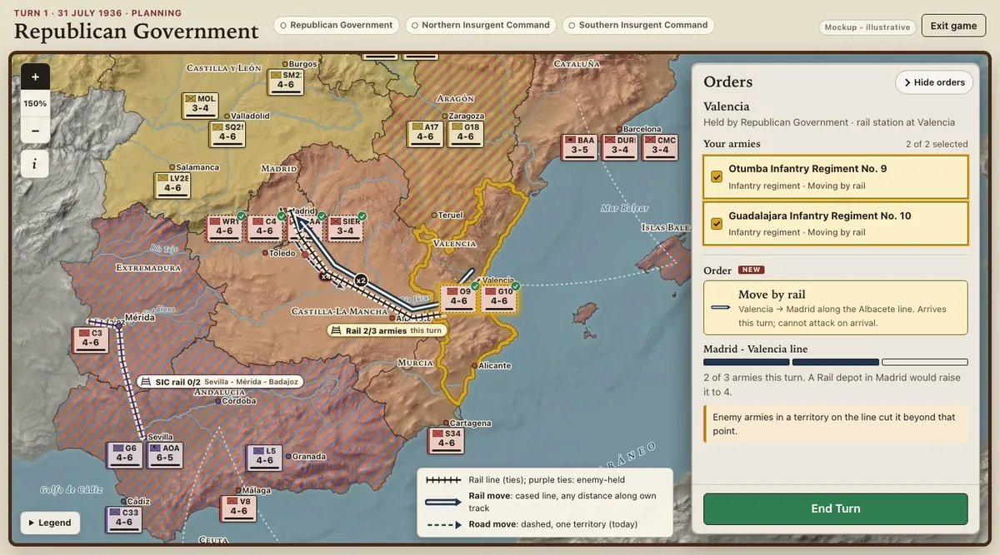
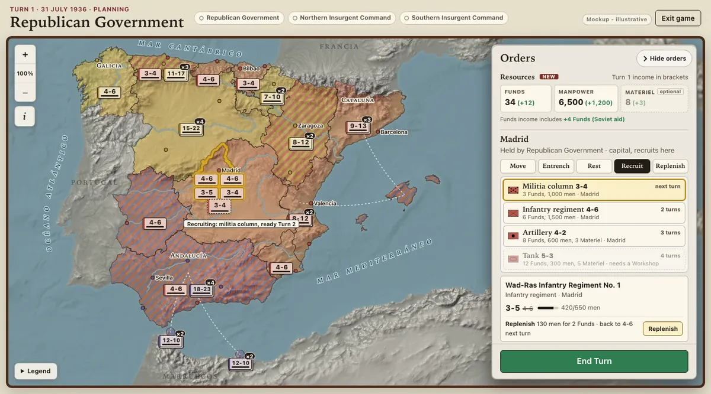
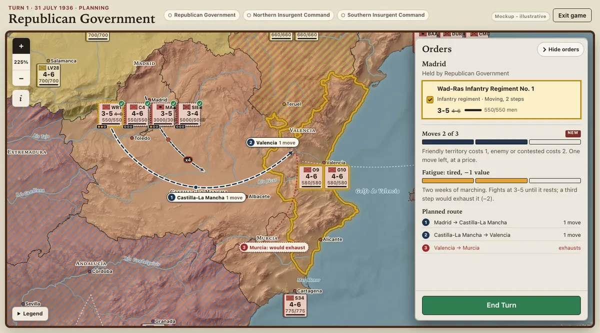

<!-- Generated by tools/assemble.mjs from research/*.sections.md, research/*.questions.json, and tools/*.md. Diff this file; read the HTML. -->

Design review &middot; Milestone 3

# Milestone 3 Ideation

19 November 2026Branch <code>m3-ideation</code>Base <code>main</code> at <code>d7f3006</code>13 ideas &middot; 6 research clusters

This review covers the owner's 13 Milestone 3 ideas. For each idea we checked game precedents, designer notes, reviews, and Spanish Civil War history. We then mapped each idea onto today's engine and turned it into options and multiple-choice questions. It replaces the older draft `project/milestones/milestone3.md`, and it is ideation only: nothing in the game was changed or tuned.

**How to use this page.**
- Each idea ends with its questions. The recommended option is listed first and marked.
- Answers are saved in this browser as you go.
- **Copy my answers** in the contents panel gives you Markdown keyed by question id, to paste back to the team.
- **Use recommended for blanks** fills only the questions you have not answered. Change any you disagree with.
- Every question also has a notes box.
- The widgets are live, and they use the real numbers from `scenario.json` where there are any.
- The mockups are drawn over real captures of today's app and labelled as illustrative.

## The short version

The order matters more than the ideas themselves. Three of the 13 are platform work: the harness (11), the data model (13), and the build process (10). Those come first, because every other idea changes balance, and today balance can only be measured with one 200-game soak test. Sub-regions (7) and graded d20 results (9) come next, since cities (4), resource collection (2), recruitment (1), and supply all depend on them. Everything else adds content on top.

| Idea | Recommended direction | Where it lands |
|---|---|---|
| 11 Harness | `npm run sim` CLI over worker threads, sharing one game loop with the soak; JSON, CSV, and HTML output with Wilson intervals; paired-seed A/B variants | M3 rev 1 |
| 13 Generic engine | Numbers in data, algorithms as named, tested modules picked by a `rules` object; AI weights move to data now (put to the owner as Q-DATA-1) | M3 rev 1 |
| 10 Process | A CI gate on every push, a short steering file, a contract stream first, a file-ownership table, and the harness as a merge gate; at most 3 to 4 streams | M3 rev 1 |
| 3 Timed turns | Each player's clock runs only on their own planning screen; on timeout, planned orders lock and other armies hold; Off, 1, 5, 10 min now | M3 rev 1 |
| 7 Sub-partitioning | About 55 sub-regions (the 1936 provinces, with overrides) decide control, cities, income, and supply; moves and battles stay on the 18 territories | M3 rev 2 |
| 9 d20 | An 11-grade ladder; each grade sets losses (10, 20, or 35 percent), morale, and ground taken; the chance to take a territory stays within 5 points of today | M3 rev 2 |
| 2 Resources | Funds and Manpower, plus a build limit per site; oil and food fold into Funds and foreign aid; political capital and action points deferred | M3 rev 3 |
| 1 Recruitment | Separate Recruit and Replenish orders (not "reinforce"); militia trains in 1 turn and other types in 2; Replenish restores up to half establishment per turn | M3 rev 3 |
| 4 Cities | Cities become features of a sub-region, and armies are no longer stationed in them; four buildings (Depot, Workshop, Fortifications, Port); sieges through supply | M3 rev 3 |
| 12 Weather | Four climate zones, each with a table for every month, rolled and shown before planning; soft effects only | M3 rev 4 |
| 8 Unit types | Artillery with the owner's rule on the d20 scale, capped at +3; air as abstract faction wings; commanders as display-only chips; tanks, cavalry, and AA deferred | M3 rev 4 partly |
| 6 Movement | Keep one move per turn; three straight turns of attacking demoralize an army; drop action points | M3 rev 4 |
| 5 Rail | Three track levels that set capacity and range, rail moves into friendly ground only, and a one-level drop on capture | Later |

**Biggest risks.**
- **Balance.** Every new rule may move the 58 percent freeze rate. Economy, weather, and faded results all lean toward more stalemate, and only the harness can tell.
- **Two cluster conflicts.** Which grades take a whole territory, and whether standing battles stay. See "Tensions and risks".
- **Orders.** The new orders are the first that are not moves.

**Research status.** Web search and fetch worked for all six clusters, at about 18 to 31 calls each. Some sources could not be read:
- **Blocked:** the GMT Paths of Glory rules PDF (403), the Unity of Command II manual (image-only), the HOI4 wiki, the War in the East 2 rules site, the OCS rules, a Paradox forum thread, and the tsx docs. Claims from those games are tagged as recall or as search snippets.
- **No source found:** VR Designs' "Spain 1936", "Brother Against Brother", Backstabbr's and Neptune's Pride's timeout behaviour, or Civilization's timer behaviour.

Every claim made from memory is tagged "(from recall, unverified)" in the text.

---

# Platform first

The harness, the data model, and the way we build decide how cheaply every later idea can be tried and measured.

---

## Idea 11: Headless balance harness

### Summary
A test platform that runs 10, 200, or 1000 all-computer games headlessly and in parallel to evaluate balance and outcomes.

### Findings
- **Today's soak is fast but blind.** One run of `src/test/soak.test.ts` (200 seeded Spain games, 30-turn cap, plus three small runs) took 2.99 s in Vitest (import 2.66 s, which holds the 200-game run because it is called in the `describe` body) and 3.70 s wall clock on one core of a 10-core machine. That is **about 12 ms per game**, so 1000 games take about 12 s on one core. It reports only totals: no per-game rows, no intervals, no battle statistics, no output file. Vitest parallelises by file, so the soak always uses one core ([Vitest pool docs](https://vitest.dev/config/pool)).
- **Parallelism is headroom, not the urgent gap.** It pays off once Milestone 3 rules slow turns, games run longer, or we sweep rule variants.
- **Running TypeScript outside Vitest.** Node 24 strips types but requires explicit file extensions and ignores `tsconfig.json`; it points to `tsx` for full support ([Node.js TypeScript docs](https://nodejs.org/api/typescript.html)). Our `src/main` imports are extensionless and `builtInSources.ts` uses Vite's `import.meta.glob`, so a plain `node` CLI cannot import the engine today. Bundling a Node entry with Vite (already a dependency) avoids both problems (from recall, unverified).
- **How studios balance with data.** Mega Crit logged every decision in Slay the Spire, read pick rates and presence in winning decks, grew from 3 to 90+ graphs, and required a specific question for each analysis ([Game Developer](https://gamedeveloper.com/design/how-i-slay-the-spire-i-s-devs-use-data-to-balance-their-roguelike-deck-builder)). Hearts of Iron IV has a `-hands_off` AI-only mode that dumps monthly history and logs declared test conditions as pass or fail ([HoI4 1.9 dev diary](https://devtrackers.gg/heartsofiron/p/95e1d0e2-dev-diary-1-9-patchnotes-and-modding-updates)). Research simulators balance Hearthstone and Dominion by playing AI agents against card definitions ([Evolving the Hearthstone Meta](https://arxiv.org/pdf/1907.01623); [Dominion card sets](https://typeset.io/pdf/evolving-card-sets-towards-balancing-dominion-2zsk143ap7.pdf)), and need a stated target to search for ([Metagame Autobalancing](https://arxiv.org/pdf/2006.04419v1.pdf)).
- **Designers' limits.** Cole Wehrle tuned Root with programs that "played through different situations", but a simulation "can only answer questions you can pose precisely" and "cannot tell whether a game is fun" ([Engines of Our Ingenuity](https://engines.egr.uh.edu/episode/3374)); chart distributions, because averages hide outliers ([Skeleton Code Machine](https://www.skeletoncodemachine.com/p/python-game-design)).
- **Intervals (Wilson, 95 percent, [formula](https://en.wikipedia.org/wiki/Binomial_proportion_confidence_interval)).** Southern wins 13 of 103 decided games: 7.5 to 20.4 percent, a real weakness. Republic 42 (31.8 to 50.4) versus Northern 48 (37.3 to 56.2) is noise. With half of games decided, a 13 percent share spans 1.7 to 57 percent over 10 games, 7.8 to 20.8 over 200, 10.4 to 16.2 over 1000. Detecting a freeze drop from 58 to 48 percent needs about 390 games per variant (unpaired); 58 to 53 percent needs about 1,550.
- **Elo** rates players, not sides (from recall, unverified): with one computer player on every side, win share per faction with an interval is the measure; Elo suits a later AI ladder.

### Fit with today's engine
- No M-rule changes. A game is already a pure function of scenario, seed, and computer-player weights (M26 seeded streams; the R3 determinism test).
- Move the per-game loop from `src/test/soakRun.ts` to a pure `src/main/sim/playGame.ts` returning one `GameSummary` per seed (winner, length, freeze turn, battles, M16 results by odds column, losses per faction, first-turn moves), plus `src/main/sim/summarize.ts` (aggregates and Wilson intervals). `soak.test.ts` keeps its 200-game S1-S3 checks on the same core.
- New `scripts/sim/cli.ts` and `scripts/sim/worker.ts`, `vite.sim.config.ts` (SSR build to `build/sim-bin/`), `npm run sim -- --games 1000 --workers 8 --scenario spain-1936-07-31 --variant v.json --out build/sim/`. Seeds sharded round-robin over `worker_threads`, merged by seed, so the report is identical for any worker count (tested).
- Packages load through the existing `createScenarioRegistry(sources)` injection; asset checks need only path keys.
- Report: `summary.json`, `games.csv`, and an HTML page; metadata includes git SHA, scenario hash, ruleset and modules, AI profile, seed range, and variant patch.
- Variants are JSON patches over the scenario (for example `combat.diggingIn.max: 2`) run on the same seeds, so A/B comparisons share dice where the games agree.

### Options
| Option | What it is | Tradeoffs | Complexity | Genericity |
|---|---|---|---|---|
| A. Vitest only | Keep the soak in Vitest; split seeds over several soak files so the pool runs them in parallel | No new tooling; reports and ad-hoc runs awkward; slows `npm test` | Low | Any scenario Vitest can load |
| B. Vite-bundled CLI with worker threads | `npm run sim` builds a Node bundle with Vite, runs games across workers, writes JSON, CSV, HTML | No new dependency; same resolver as the app; one-second build step | Med | Any scenario and ruleset; variants by JSON patch |
| C. tsx CLI with worker threads | Same CLI run through `tsx`, packages read with `fs` | No build step; new dev dependency; worker loader behaviour unverified | Med | Same as B |
| D. Defer | Keep the 200-game soak as is | Free now; Milestone 3 balance work stays blind | Low | None added |

**Recommendation:** Option B, with the pure game core shared by the CI soak and the CLI, paired-seed variants, and Wilson intervals on every share. It reuses tooling we already trust and makes balance questions answerable in seconds; parallelism is a cheap bonus that matters once Milestone 3 slows turns down.

### Widget
*Interactive widget `harness-estimator`: open the HTML report to use it.*
Estimates wall time for a run from games, turns, workers, and milliseconds per game (default 12 ms, measured on this machine's one soak run), and shows the 95 percent Wilson interval for a faction's win share at that game count.

### Mockup

### Questions
**Q-HARN-1** How should the headless harness run?
1. A command-line tool (npm run sim) bundled by Vite, running games across worker threads and writing JSON, CSV, and an HTML report **(Recommended)** - No new dependency, same module resolution as the app, and reports that can be compared run to run.
2. The same command-line tool run through tsx, with no build step
3. Inside Vitest only, with seeds split across several soak files
4. Drop this idea or defer it
5. Other / notes: ____

**Q-HARN-2** Which run sizes should be standard?
1. 200 games in every npm test (as today), 1000 games on demand with npm run sim **(Recommended)** - 200 games (about 103 decided) catch large imbalances (a 13 percent share of decided games spans 8 to 21 percent); 1000 games narrow it to about +/- 3 points and take seconds.
2. Only 10-game smoke runs in npm test; 200 and 1000 on demand
3. 1000 games in every npm test
4. Other / notes: ____

**Q-HARN-3** Which metrics must the first harness report carry? Choose all that apply. *(choose all that apply)*
1. Recommended set: win share per faction with 95 percent intervals, decided and freeze rates, game-length distribution, battles per turn and results by odds column, losses per faction, first-turn moves **(Recommended)** - Answers the open balance questions (freezes, the Southern command) and checks the combat table behaves as designed.
2. Per-territory capture counts for a map heat view
3. Economy per faction per turn (income, spending, stockpile, recruits), once the economy exists
4. Computer-player behaviour: share of armies that never move, offensives started and abandoned
5. Other / notes: ____

**Q-HARN-4** Should harness results fail the build?
1. Keep today's guards (no early wins, no abandonments, determinism) as failures; report balance numbers with intervals without failing **(Recommended)** - Balance moves with every rule change; failing the build on it would force tuning loops the owner ruled out (P3).
2. Also fail the build when the freeze rate exceeds its budget
3. Fail the build on any faction's share leaving a target band
4. Never fail the build on the soak; report only
5. Other / notes: ____

**Q-HARN-5** How should we compare rule variants (A/B)?
1. Variants are small JSON patches over the scenario (for example digging-in cap 2), run on the same seeds as the baseline, with the difference and its interval reported **(Recommended)** - Paired seeds cut dice noise, and patches never change the shipped scenario.
2. Variants are full copies of the scenario package
3. No A/B support; compare separate runs by eye
4. Other / notes: ____

**Q-HARN-6** Which computer opponents should the harness pit against each other?
1. Today's computer player on every side, with a per-faction AI profile (weights) that a variant can change **(Recommended)** - Separates rule balance from AI quality and lets us test whether the Southern weakness is the AI or the board.
2. Also a random-legal player as a baseline (plan.md section 12.2)
3. Today's computer player only, no profiles
4. Other / notes: ____

**Q-HARN-7** Where should the harness report be read?
1. A generated HTML page in build/sim/ next to summary.json and games.csv **(Recommended)** - Readable in the morning without tools; the JSON and CSV feed any deeper analysis.
2. Console summary and JSON only
3. A developer screen inside the game
4. Other / notes: ____

---

## Idea 13: A generic engine, game modes as data

### Summary
Keep the engine generic so new eras (WW1, WW2, Russian Revolution, Seven Years' War, Napoleonic) are mostly new JSON and images, with a `spain-civil-war-scenario.json` holding this game's details, possibly including AI strategies, resource types, and unit types.

### Findings
- **Named modules with parameters is the proven pattern.** Battle for Wesnoth defines abilities and weapon specials as named tags (`heals`, `leadership`, `drains`, `slow`, `poison`, `firststrike`) tuned by keys such as `value`, `add`, `multiply`; an unknown tag does nothing, which implies the behaviour for each name is coded in the engine ([Wesnoth AbilitiesWML](https://wiki.wesnoth.org/AbilitiesWML)). Ludii, a general game system, writes games as "ludemes" ([arXiv 1905.05013](https://arxiv.org/abs/1905.05013v3)) whose language is generated from the class hierarchy of its source code ([Ludii overview](https://ar5iv.labs.arxiv.org/html/1907.00240)): even the most general system names coded parts rather than encoding algorithms as data.
- **AI weights in data are proven too.** Paradox scripts weight AI choices with `ai_will_do` factors that multiply per applicable modifier (forum threads seen in search results, not opened, e.g. [How do weight factors work](https://admin-forum.paradoxplaza.com/forum/threads/how-do-weight-factors-work.939900)); HoI4 lets modders add AI strategies that override behaviour ([HoI4 1.9 dev diary](https://devtrackers.gg/heartsofiron/p/95e1d0e2-dev-diary-1-9-patchnotes-and-modding-updates)). Our `computerWeights`, `offensiveWeights`, `stakeWeights`, and `victoryAlarm` are numbers in code today.
- **One engine across eras works when differences are units and parameters.** Strategic Command WWI "runs on the same upgraded engine" as the WWII games, adding unit types, trench research, mines, and artillery-spotting recon bombers ([Steam](https://store.steampowered.com/app/1096930/Strategic_Command_World_War_I/)).
- **Each era adds one to three algorithms.** WW1: replacement points, strategic redeployment by rail, trenches (Paths of Glory sections 9.4, 13.0, 11.2, [rulespal](https://rulespal.com/paths-of-glory/rulebook)). Russian Civil War: armoured trains that "may only move, attack or retreat along contiguous rail hexes", rail movement capped per phase, rail as supply lines ([Reds! rulebook](https://rulespal.com/reds/rulebook)). Seven Years' War: logistics phases with supply, sieges, and winter quarters ([Frederick II](https://www.grognard.com/info1/frederickII.doc); [Clash of Monarchs](https://rulespal.com/clash-of-monarchs/rulebook)). Napoleonic: generals with command ratings capping corps, and attrition when a hex holds more corps than its forage value ([campaign rules](https://dantes-game.blogspot.com/p/napoleonic-wars-campaign-rules.html); [The Sun of Austerlitz](https://rulespal.com/the-sun-of-austerlitz/rulebook)). WW2: air missions, oil, production, exploitation moves (from recall, unverified).
- **The tension, for the owner.** `coding-principles.md` says "Avoid premature generic abstractions"; Revision 6 section 1.6 kept the resolution algorithm in code because "encoding the algorithm itself as data would make it untestable". The owner's north star wants eras swappable by data, but hedges ("if our engine is flexible enough", "the other game types will come later"). The middle ground: **parameters in data; named rule modules in code, selected by data, each with its own spec rules and tests.** A new era is new JSON plus at most a few new modules, never an engine fork, and data never holds formulas.

### Fit with today's engine
- Already data: unit values, the combat block (table, below-1:1, digging in, demoralization, faction modifiers), victory shares, factions, board, starting armies. The loader already composes and validates once (L1-L13).
- Moves into data: AI profiles (the four weight constants in `src/main/ai/`, per faction), turn calendar (start date, 14-day turns; no field exists today), resource types, costs and yields, weather tables, unit costs, training turns, and unit effects as a coded list of effect kinds.
- Becomes named modules selected by a new `rules` object: dice and resolution (`d6-table`, `d20-graded`), economy, recruitment, weather, supply, movement, partition. `m2-strength` survives as a preset of those modules.
- Files: `scenarioSchema.ts` and the generated `scenario.schema.json`, `engine/types.ts` (`supportedRulesets`), `loader.ts` (new checks that modules and data blocks match), `ai/computerPlayer.ts`, `ai/offensive.ts`, `ai/assessment.ts`, `project/specs/scenario-package.md` (spec version 2).
- M-rules: M15's die range and row clamp become per dice module (d6 rows 0..6 today); M25 is the rule recruitment relaxes; M26 gains steps for the selected modules (income, recruitment, weather). `map.json` needs a `unitSymbols` entry for every new unit type (L10) and new icons for resources and weather.
- File layout: today one folder per package (`src/main/scenarios/spain-1936-07-31/scenario.json` + `map.json`), found by the glob `*/scenario.json` in `builtInSources.ts`. For Milestone 3, that `scenario.json` plays the role of the owner's `spain-civil-war-scenario.json`, gaining a `rules` section. When a second start date (1937, 1938) is planned, split it into `src/main/modes/spain-civil-war/mode.json` (rules and board) plus `starts/1936-07-31.json`. Using the owner's literal file name instead means changing the glob. The loader composes any layout into today's `Scenario` type, so the engine never sees the difference.

### Options
| Option | What it is | Tradeoffs | Complexity | Genericity |
|---|---|---|---|---|
| A. Parameters in data, named modules in code | Data selects coded modules and tunes them; modules have spec rules and tests | Testable; a new era may need a few new modules | Med | High for numbers, Medium for new mechanics |
| B. Rules as data (a small rules language) | Formulas, triggers, and effect scripts in JSON | Eras swap without code; untestable, hard to explain in battle reports; rejected in Revision 6 section 1.6 | High | Highest on paper |
| C. Status quo, generalise on demand | Keep Milestone 3 mechanics in code; move things to data only when a second mode needs them | Cheapest now; Spain-specific assumptions creep into code; AI weights stay constants | Low | Low |

**Recommendation:** Option A, put to the owner as Q-DATA-1: it honours both the north star and the "no premature abstraction" principle, because only things that are already numbers move to data, and every algorithm stays a named, tested module. Move AI weights into data now; it costs little and lets the harness A/B them.

### Widget
*Interactive widget `data-or-code`: open the HTML report to use it.*
Toggle each game element between data, named module, and code to see the estimated schema fields, test surface, and which future eras the engine could then load without an engine fork; estimates are from this cluster's era check.

### Questions
**Q-DATA-1** Where should the line between data and code sit?
1. Parameters in data; named rule modules in code, selected by data, each with its own spec rules and tests **(Recommended)** - Honours the north star and the 'no premature abstraction' principle; matches Wesnoth and Ludii, and keeps rules testable (Revision 6 section 1.6).
2. Rules as data: formulas, triggers, and effect scripts in JSON
3. Keep Milestone 3 mechanics in code; move things to data only when a second game mode needs them
4. Other / notes: ____

**Q-DATA-2** How should the Spain game's data files be laid out?
1. One file per scenario: src/main/scenarios/spain-1936-07-31/scenario.json plays the role of spain-civil-war-scenario.json, gaining a rules section (modules, unit types, combat, resources, weather, AI, calendar); split into a shared game-mode file when a second start date is planned **(Recommended)** - One file holds everything, as the owner expects, with no loader change; the split later is mechanical because the loader composes files into one Scenario.
2. Split now: src/main/modes/spain-civil-war/mode.json (rules and board, the owner's file) shared by starts/1936-07-31.json and later 1937 and 1938 starts
3. Rename to the owner's literal name, src/main/scenarios/spain-civil-war/spain-civil-war-scenario.json (the loader glob for */scenario.json changes)
4. One scenario file that extends a shared rules file and overrides parts of it
5. Other / notes: ____

**Q-DATA-3** Should computer-player weights move into the scenario data?
1. Yes: named AI profiles in data, one per faction, holding today's computerWeights, offensiveWeights, stakeWeights, and victoryAlarm numbers; the strategy logic stays in code **(Recommended)** - They are already plain numbers; in data the harness can A/B them per faction, as Paradox scripts AI weights.
2. Yes, and let data choose among several coded strategies per faction
3. No: keep them as code constants
4. Other / notes: ____

**Q-DATA-4** How should unit special effects (artillery roll bonus, bombing a town) be expressed?
1. Data names an effect kind from a coded list and gives its numbers, for example roll-bonus-per-points with per 3, bonus 1 **(Recommended)** - The Wesnoth pattern: each kind is tested once and reused by every era.
2. Free-form formulas in data
3. Code per unit type
4. Other / notes: ____

**Q-DATA-5** How much should Milestone 3 design for future eras?
1. Check each new module on paper against one other era (WW1 is the closest), and build nothing for other eras yet **(Recommended)** - Catches Spain-only assumptions cheaply while the owner says other game types come later.
2. Build a small second test scenario in another era to prove the engine
3. Design only for Spain; generalise when a second era starts
4. Other / notes: ____

**Q-DATA-6** Should the turn calendar (start date and 14-day turns) become scenario data now?
1. Yes: a calendar block with start date and turn length in days, shown on the turn banner **(Recommended)** - Weather by month needs a date, and other eras use other turn lengths.
2. Only if the weather idea is accepted
3. No: keep turns numbered without dates
4. Other / notes: ____

---

## Idea 10: How we build with agents

### Summary
Review how Milestone 2 was built by AI agents (research report, Q&A, tasks doc, parallel worktree streams, integrator, decision log) and find ways to use agents more efficiently in Milestone 3.

### Findings
What the decision logs show (ids are revision plus entry, for example R5 D30):

- **Red commits, and no independent check.** R5 D30: two commits landed with failing checks, one because "a too-narrow output filter hid" a lint error. R5 D63: two of three feedback merges failed tests until a follow-up commit, and the log says to skip those commits when bisecting. R5 D14 and the Phase 4 handoff each ended in one combined commit. Rev 6 and 7 kept the integration line green by folding fix-ups into merges (R6 D8, R7 D20). But in R7 D34 the owner waived the final verify and production smoke, and the repository has no `.github/` CI, so nothing outside the agents ever checked a commit.
- **Contract first worked.** R6 D5 moved the pure combat maths into the contract stream, "so the presentation stream (F) gets real numbers as soon as D merges". Where the contract was late, R6 D17 shows a duplicate key list.
- **Layer-split streams were coupled.** In R6 D42, data and the computer player had to land together. In R6 D52, the freeze of 200 of 200 games appeared only after the merge. Rev 7's four per-feature streams merged in about 15 minutes, with one textual conflict (R7 D28, `CampaignMap.tsx`) and about three semantic ones (D24, D25, D27). Rev 7 was also six times smaller, so this comparison is confounded.
- **Budgets and debt drift.** Raising budgets: the soak budget (R6 P3, "read only its summary line") held in R7 D32, but the integrator raised its own chunk budget in R6 D62. Rolling follow-ups: files over 200 lines grew from 3 to 5 across three revisions (`CampaignMap.tsx` went 227, 230, 236), and manual accessibility checks and OD-3 sign-off have rolled over since Rev 5.

Current practice:
- Anthropic separates instructions that an agent may skip (CLAUDE.md, prompts) from enforced ones ("Tests, typecheck, a `Stop` hook, CI"). It advises a short CLAUDE.md (under 200 lines) and a fresh reviewer subagent that "isn't swayed by the reasoning that produced the code" ([Claude Code best practices](https://code.claude.com/docs/en/best-practices)).
- Anthropic's own multi-agent system used about 15 times the tokens of chat, and the post notes that coding has fewer truly parallel tasks than research ([Anthropic](https://www.anthropic.com/engineering/multi-agent-research-system)). Agent teams docs say same-file edits overwrite each other, so give each worker its own files, and start with 3 to 5 teammates ([agent teams](https://code.claude.com/docs/en/agent-teams)).
- Spec tools (spec-kit, Kiro) formalise our report, tasks, and waves ([GitHub](https://github.blog/ai-and-ml/generative-ai/spec-driven-development-with-ai-get-started-with-a-new-open-source-toolkit/), [Kiro](https://kiro.dev/docs/specs/)). Critics find them heavy for small changes ([Boeckeler](https://martinfowler.com/articles/exploring-gen-ai/sdd-3-tools.html)).
- Review is the bottleneck ([Willison](https://simonwillison.net/2025/Oct/5/parallel-coding-agents/)), and small batches are a safety net for AI-written changes ([DORA](https://dora.dev/capabilities/working-in-small-batches/)).

### Fit with today's engine
- **New files, no game code.**
  - `.github/workflows/ci.yml`: lint, typecheck, unit tests (the soak already runs inside them), `spec:check`, and build. Optional Chromium e2e, without `e2e/visual.spec.ts`, because macOS baselines likely differ on Linux runners (from recall, unverified).
  - A short `CLAUDE.md`.
  - `.claude/settings.json` with a `Stop` hook running typecheck and lint, and a hook that blocks edits to `e2e/baselines/**` outside the integrator.
  - `.claude/agents/reviewer.md`, a read-only reviewer.
- **Cost.** Locally, lint takes about 5 s, typecheck about 2 s, and the unit suite about 7 s (483 tests), so a CI run is probably 2 to 4 minutes including `npm ci` (a guess). GitHub Free includes 12 USD of compute a month, and public repositories run free ([GitHub](https://docs.github.com/en/billing/concepts/product-billing/github-actions)).
- **Contract stream for M3.** It owns:
  - `engine/types.ts` (440 lines) and `scenarios/loader.ts` (434);
  - the schema files and `project/specs/scenario-package.md`;
  - the new ruleset id (mismatch d);
  - the pure maths for costs, yields, and weather odds.
- **Split hotspots first.** Split `CampaignMap.tsx` (236 lines) and `state/planning.ts` (239) before the parallel phase, because cities, rail, partitions, and units all touch them.
- **Soak.** Move it out of `src/test/soak.test.ts` into the harness (idea 11), printing a one-line JSON summary checked against bands that the owner owns.

### Options
| Option | What it is | Tradeoffs | Complexity | Genericity |
|---|---|---|---|---|
| A. Guardrails only | CI gate, a short CLAUDE.md, two or three hooks; process otherwise unchanged | About an hour to set up. Stops red commits and gives a check that still runs when the local verify is waived. Leaves stream coupling, rolling debt, and integrator-owned budgets alone | Low | Applies to any revision or scenario |
| B. Gated slices | A, plus: a contract stream first; per-idea vertical slices; 3 or 4 streams at most; a file-ownership table; a harness gate with owner-owned budgets; a read-only reviewer per stream; stored answers feeding the tasks doc; a debt slot | Covers every problem in the evidence. Costs a serial contract phase and about one extra agent run per stream for review (estimate) | Med | The contract, slice, and gate pattern suits later scenarios (WW1, WW2) as well |
| C. Full orchestration | B, plus scripted multi-agent workflows or agent teams, cloud runs, spec-kit or Kiro specs per idea | Most automation, but experimental features, many times the tokens, a heavy spec review burden, and coding parallelises poorly | High | Generic, but locks the process into tooling |
| D. One agent, in sequence | One agent works through the steps in order, like Rev 5's first pass | No merge conflicts, but slow. Rev 5 still had red commits (D30) and a combined commit (D14) | Low | Neutral |

**Recommendation:** Option B, starting with its cheapest parts: the CI gate and a short CLAUDE.md first, then a contract stream and file-ownership table (most M3 ideas share the schema and map files), then the harness gate and a reviewer subagent. Keep 3 or 4 streams at most, and defer agent teams, scripted workflows, and cloud runs until the gates are working.

### Widget
*Interactive widget `process-planner`: open the HTML report to use it.*
Pick one of the three observed setups (Rev 5, 6, or 7) to see what actually happened: streams, gate, slicing, diff size, red commits, conflicts, fix-ups, and time. Numbers come from the declogs and commit timestamps, with no extrapolation.

### Questions
**Q-PROC-1** Should Milestone 3 add a CI gate (GitHub Actions), and what should it run?
1. Lint, typecheck, unit tests (with the soak), spec:check, and build on every push to an integration branch and every pull request to main; main protected by it **(Recommended)** - Rev 5 D30 and D63 show red commits, and the repo has no CI; lint, typecheck, and unit took about 15 s locally (build not timed), so a run likely costs a few minutes.
2. The same, plus Chromium e2e without the visual baseline spec
3. The same, plus every browser and the visual baselines (needs Linux baselines)
4. Drop this idea or defer it
5. Other / notes: ____

**Q-PROC-2** In Rev 7 (D34) you waived the final verify and production smoke. With CI in place, CI would be the check that still runs when you waive the local verify. How should final checks work in Milestone 3?
1. You can still waive the local verify and smoke test, but the squash to main goes through a pull request that CI must pass **(Recommended)** - Keeps your choice to skip the slow local pass while guaranteeing an independent check on every commit that reaches main.
2. The local verify and production smoke are always required; no waivers
3. Keep today's practice: the integrator runs checks locally and you may waive them
4. Other / notes: ____

**Q-PROC-3** How should Milestone 3 work be split into streams?
1. A short contract stream first (types, schema, loader, ruleset id, pure maths), then one vertical slice per idea (engine, data, UI, and tests together) **(Recommended)** - Rev 6 D5 shows contract-first works; Rev 6 D42 and D52 show layer-split streams had to land together or broke only after merging.
2. Contract first, then streams by layer (engine, presentation, data, art) as in Rev 6
3. No contract stream; independent per-idea streams from the start, as in Rev 7
4. One agent working through the steps in sequence
5. Other / notes: ____

**Q-PROC-4** How many workstreams should run at once in a Milestone 3 revision?
1. 3 or 4, with hotspot files (CampaignMap.tsx, planning.ts, types.ts, the schema) owned by one stream each and split before the parallel phase **(Recommended)** - Rev 7 ran 4 streams with 1 textual conflict; Claude Code's own guidance starts teams at 3 to 5, and your review time is the bottleneck.
2. 5 to 8, as in Rev 6
3. 2
4. 1 (sequential)
5. Other / notes: ____

**Q-PROC-5** Should each stream get an independent, read-only reviewer agent before it hands off?
1. Yes: one reviewer per stream that reads the diff against the tasks decisions that stream owns, reports only correctness gaps, and skips style **(Recommended)** - Rev 7 needed 9 fix-ups at integration across 4 merges, and the rubric is self-scored (R13 scored 5 with the verify waived); a fresh reviewer has not seen the author's reasoning.
2. One reviewer pass over the whole revision, at the end
3. Drop this idea or defer it
4. Other / notes: ____

**Q-PROC-6** Some follow-ups have rolled over for three revisions (files over 200 lines, manual accessibility checks, OD-3 historical sign-off, the initial-chunk budget). How should Milestone 3 handle them?
1. All three: split the hotspot files (CampaignMap.tsx, planning.ts, useMapCamera.ts, combat.ts) in the first M3 contract stream; schedule or formally defer the person-only checks (screen reader, 200 percent zoom, OD-3); move owner-owned budgets (freeze rate, chunk size) into one file a gate reads **(Recommended)** - The over-200 list grew from 3 to 5 files, CampaignMap.tsx (227, 230, 236 lines) was the Rev 7 conflict file, agents cannot do person-only checks, and Rev 6 D62 shows an agent raising its own budget.
2. Only split the hotspot files
3. Only schedule or formally defer the person-only checks
4. Drop the 200-line target and the manual checks from the Definition of Done
5. Keep carrying them as follow-ups
6. Other / notes: ____

**Q-PROC-7** How should the research report and your answers feed the tasks document?
1. A full ideation report for each milestone, a few direct questions for small revisions (as in Rev 7), and your answers saved as JSON next to the questions so the tasks decisions table is generated from them **(Recommended)** - Rev 6's Rec and Changed table made answers traceable; Rev 7's light path saved time; storing answers as data removes a manual transcription step.
2. A full research report for every revision
3. Keep today's flow, with answers transcribed by hand
4. Drop this idea or defer it
5. Other / notes: ____

**Q-PROC-8** Should the repository get a short CLAUDE.md plus a few enforced hooks?
1. Yes: a CLAUDE.md of under about 60 lines (commands, ports, gate-on-exit-codes, baseline and ASCII rules, where decisions live), a Stop hook running typecheck and lint, and a hook blocking baseline edits outside the integrator **(Recommended)** - Today the shared rules are restated in each tasks doc and plan.md is 1,148 lines; Anthropic advises a short CLAUDE.md and hooks for rules with no exceptions.
2. CLAUDE.md only, no hooks
3. Drop this idea or defer it
4. Other / notes: ____

---

# The map underneath

Sub-regions are the floor that cities, rail, and resource collection stand on.

---

## Idea 7: Territory sub-partitioning

### Summary
Split a territory into historical sub-regions (NUTS3 or provinces) during combat, so it can be held in part. Make income follow the parts, and possibly movement too.

### Findings
- **NUTS3 is not the 1936 provinces, though it is close.**
  - **1936 had the same 50 provinces as today.** The 1833 decree created 49 provinces. A 1927 decree split the Canaries in two, making 50 ([1833 division](https://en.wikipedia.org/wiki/1833_territorial_division_of_Spain); [Province of Canary Islands](https://en.wikipedia.org/wiki/Province_of_Canary_Islands)).
  - **NUTS3 differs in three places.** NUTS3 is "Provinces + Islands + Ceuta and Melilla" ([NUTS of Spain](https://en.wikipedia.org/wiki/NUTS_statistical_regions_of_Spain)):
    - Baleares splits into ES531 Eivissa y Formentera, ES532 Mallorca, and ES533 Menorca.
    - The Canaries split into seven islands.
    - Ceuta (ES630) and Melilla (ES640) are units of their own ([Eionet NUTS 2021](https://dd.eionet.europa.eu/vocabulary/common/nuts2021/view?page=43)).
  - **Ceuta and Melilla were not provinces in 1936.** They "were formerly part of Cadiz and Malaga provinces" ([Provinces of Spain](https://en.wikipedia.org/wiki/Provinces_of_Spain)).
- **Provinces per scenario territory: 48 in total.**
  - Castilla y Leon 9, Andalucia 8, Castilla-La Mancha 5, Galicia 4, Cataluna 4, Pais Vasco 3, Aragon 3, Valencia 3, Extremadura 2.
  - Seven territories have 1 each; Ceuta and Melilla have 0. Membership is from recall; the total of 50 is cited.
  - **The problem:** province level cannot split Asturias (Oviedo against Gijon) or Madrid. Yet Madrid is `plan.md`'s own partition example.
  - **The fix:** NUTS3's island split happens to match 1936, when Mallorca and Ibiza were with the rising and Menorca stayed loyal ([Battle of Majorca](https://en.wikipedia.org/wiki/Battle_of_Majorca)).
- **31 July 1936, by province capital** ([es.wikipedia, Golpe de Estado de julio de 1936](https://es.wikipedia.org/wiki/Golpe_de_Estado_en_Espa%C3%B1a_de_julio_de_1936); [Spanish coup of July 1936](https://en.wikipedia.org/wiki/Spanish_coup_of_July_1936)):
  - Andalucia is Sevilla, Cadiz, Huelva (city taken 29 July), Cordoba and Granada for the rising. Cordoba and Granada were city only: "la provincia permanece fiel". Malaga, Jaen and Almeria were Republican.
  - Extremadura is Caceres for the rising and Badajoz Republican.
  - Pais Vasco is Alava for the rising, Vizcaya and Guipuzcoa Republican.
  - By capital holder, Asturias, Extremadura, Baleares, Andalucia and Pais Vasco start partitioned. Aragon would start wholly Northern, losing its Republican eastern strip, so it needs an override (full table in `research/map.md`).
- **Precedents.**
  - Diplomacy has no partial control; its only sub-province device is split coasts (from recall, unverified).
  - In [Here I Stand](https://rulespal.com/here-i-stand/rulebook), a fortified space changes hands only through a successful siege.
  - `plan.md` sections 6.3 and 9 already specify predefined sub-territories that lie dormant until a split.
- **Movement on sub-regions is expensive.**
  - **Graph and AI.** 55 nodes instead of 18, and every order, battle and AI distance changes ids. The AI's "three steps" planning (D58) covers a third of the ground.
  - **Tempo.** The Army of Africa crossed three province borders in about five weeks from 2 August ([Battle of Merida](https://en.wikipedia.org/wiki/Battle_of_M%C3%A9rida); Talavera date from recall). One sub-region per two-week turn needs idea 6's multi-step movement to match that.

### Fit with today's engine
- **scenario.json.**
  - New `subRegions[]`: `id`, `name`, `territoryId`, `adjacent[]` (including across territory borders), and `cityIds`.
  - New loader rules: references resolve; each territory's sub-regions are connected to each other; and a cross-border adjacency requires a territory connection.
- **GameState.** A new `subRegionControl`. `control` becomes derived: "controlled" when one faction holds every sub-region, otherwise "partitioned".
- **Rules:**
  - **M6/M7:** control comes from sub-regions.
  - **M11/M17 (rule P0):** today a move into a territory where the mover's faction already has an army is a reinforcement. In a partitioned territory, a move from outside instead attacks when an enemy sub-region borders its origin; otherwise it joins its own zone (Q-PART-8).
  - **M17/M18:** graded `ground` k flips k sub-regions (rule P1). This uses the Military ladder's `ground`: 0, 1 (`defender-gives-ground`), 2 (`defender-pushed-back`), or all.
  - **M21:** displaced defenders fall back into their own remaining sub-regions, else retreat (P2).
  - **M22:** works are kept per territory per faction.
  - **M24:** a city is held through its sub-region.
  - **M27:** replaced by a new `push` order kind. It is not a move to the army's own territory, which would break M2 and L6. The Military cluster keeps M27, so the coordinator must reconcile.
  - **P7:** an unopposed entry or Push into an ungarrisoned enemy zone takes one sub-region a turn. At the start, Caceres and Alava have no garrison.
  - **M10:** a partitioned territory counts for nobody.
- **Rule P1.** Repeat k times.
  - An entry's first pick must border its origin.
  - After that, the candidates are the defender's sub-regions bordering the attacker's own.
  - Take the candidate with the most attacker-held neighbours; break ties by scenario order.
- **Engine selection.** `rules.partition` in the Engine cluster's module object.
- **map.json and pipeline.**
  - **Pipeline:** `scripts/build-map.ts` reads only geoBoundaries ADM1 (16 regions keyed ES11 to ES62). It needs an ADM2 source, its checksum and attribution, a split of Baleares by polygon, and hand overrides for Asturias and Madrid.
  - **Map spec:** it already lets several regions share a territory. It adds `regions[...].subRegionId` and `subRegions[id].unitAnchor`.
  - **Adjacency:** it can be generated from shared border edges. That is new code beside `scripts/map/edgeIndex.ts`.
- **UI.** The territory wash is drawn per sub-region, which replaces striping. Counters are drawn at each faction's zone anchor (`CounterLayer.tsx`).

### Options
| Option | What it is | Tradeoffs | Complexity | Genericity |
|---|---|---|---|---|
| A. Full sub-region map | Everything (moves, battles, AI) runs on about 55 sub-regions. | The most faithful, and what the owner floated. It roughly triples the nodes, needs idea 6 movement points to match history, requires a broad engine rename and an AI retune, and is harder on phones. | High | High |
| B. Hybrid: sub-regions for control and income | Orders and battles stay on the 18 territories. A graded result flips k sub-regions, chosen by adjacency to the attacker. Cities, income and supply follow the sub-regions. | Delivers "contested, with its occupiers in smaller regions" and the income split. The data is reusable for A later. A whole territory remains one battle. | Med | High |
| C. Two generic halves | Every territory has zones A and B, with no geography. | Cheap, but not historical and not readable on the map. | Low | Med |
| D. Defer | Keep M27 shared territories. | No cost, but it drops `plan.md`'s headline mechanic. | None | n/a |

**Recommendation:** Option B. Use provinces by default with scenario overrides: Baleares as its three NUTS3 islands, Asturias in 2 and Madrid in 3, about 55 sub-regions in all. It delivers the owner's split and income effect now. Movement stays territory-level until idea 6 shows that multi-step movement works, and the same data then allows Option A.

### Widget
*Interactive widget `partition-splitter`: open the HTML report to use it.*
Pick Andalucia, Aragon or Extremadura, an attacker and its origin, and a graded result. It shows which provinces flip under rule P1 and the resulting income split. Starting control is the 31 July 1936 capital holders; adjacency is from recall; yields are illustrative.

### Mockup

### Questions
**Q-PART-1** Which sub-regions should a territory split into?
1. 1936 provinces, with scenario overrides: Baleares as its three islands, Asturias in 2, Madrid in 3 (about 55 sub-regions) **(Recommended)** - Historical borders straight from the data, and the overrides cover the two contested territories and Madrid that provinces alone cannot split.
2. Pure 1936 provinces (48; Asturias, Baleares and Madrid never split)
3. NUTS3 as published (52; Baleares splits, Asturias and Madrid never split)
4. Fewer merged zones, at most 5 per territory as plan.md section 9.2 says (about 35)
5. Drop this idea or defer it
6. Other / notes: ____

**Q-PART-2** Should armies move between sub-regions, or should sub-regions only decide control and income?
1. Hybrid: orders and battles stay on the 18 territories; sub-regions decide control, cities, income and supply **(Recommended)** - Gives the contested-front and income effect at about a third of the cost, and keeps the data ready for full sub-region movement later.
2. Full sub-region movement now, every army on one of about 55 sub-regions (needs idea 6 multi-step movement)
3. Sub-regions only while a territory is split; unified territories move as today
4. Other / notes: ____

**Q-PART-3** When a graded battle result says k sub-regions change hands, which ones go?
1. Automatic: the defender's sub-regions bordering the attack's origin, taking the one with the most attacker-held neighbours each time; ties by scenario order **(Recommended)** - Deterministic, explainable in one line, and grows a contiguous front from the side the attack came from.
2. The attacker names target sub-regions in its order, in priority order
3. Seeded random choice among the bordering sub-regions
4. Other / notes: ____

**Q-PART-4** How do two factions fight inside a partitioned territory?
1. An explicit Push order (a move order to its own territory) attacks the enemy zone; otherwise armies dig in and the front holds **(Recommended)** - Stable, holdable fronts are what partitioning is for; today's automatic M27 battle every turn would grind every split territory.
2. Keep M27 automatic standing battles every turn, with the graded result moving sub-regions
3. Both: automatic battles unless both sides entrench
4. Other / notes: ____

**Q-PART-5** How does a partitioned territory count toward the territory victory share?
1. It counts for nobody until one faction holds every sub-region (as contested territories do today) **(Recommended)** - No change to M10 or the victory thresholds, and it rewards finishing a territory.
2. It counts for the faction holding most of its sub-regions
3. Victory counts sub-regions instead of territories (new thresholds needed)
4. Other / notes: ____

**Q-PART-6** Where do defenders go when the sub-region they stood in is taken?
1. They fall back into the nearest sub-region of the same territory their faction still holds; if none, they retreat under M21 **(Recommended)** - Keeps the territory contested instead of emptying it, which is the point of a partial result.
2. They always retreat out of the territory under M21
3. Armies in a lost sub-region are destroyed
4. Other / notes: ____

**Q-PART-7** How should the Spain scenario start on 31 July 1936?
1. Already partitioned: each sub-region goes to the holder of its provincial capital, with hand overrides where that misleads (Aragon's Republican east); for example Andalucia 5 Southern, 3 Republic **(Recommended)** - Close to the 1936 map and turns contested flags into real fronts; the capital rule alone would hand all of Aragon to the Northern command.
2. Keep today's contested flags and let the first battles create the splits
3. Partitioned, but with each sub-region assigned by researched countryside control rather than its capital
4. Other / notes: ____

**Q-PART-8** When an army moves into a partitioned territory where its own faction already has a zone, does it fight?
1. It attacks if an enemy sub-region borders the territory it came from; otherwise it joins its own zone as a reinforcement **(Recommended)** - The front you meet is the one facing your approach, and the attack's origin then feeds the split rule; today's M11 would make every such move a non-fighting reinforcement.
2. It always joins its own zone; only a Push order from inside fights
3. The player chooses: reinforce the zone or attack the enemy zone
4. Other / notes: ____

---

## Idea 4: City interactions

### Summary
Stop armies being stationed in a city rather than the territory, and make cities interesting: build options, city resources, and different resources from rural ground.

### Findings
- **Cities are labels today.**
  - `cityId` on a unit is set only from the scenario's starting positions (`initialGameState` in `engine/resolution.ts`) and is used to draw the counter at the city (`CounterLayer.tsx`).
  - No rule reads it: M24 checks who controls a city, not who stands in it, and M7 makes a territory's cities follow its control. So "stationed in a city" is a display artefact.
- **Cities as places held.**
  - [Here I Stand](https://rulespal.com/here-i-stand/rulebook) makes fortified cities separate places: "A power must successfully besiege a fortified space to gain political control of that city".
  - 1936 is full of this. Oviedo held out under siege inside Republican Asturias, and the Toledo Alcazar held inside a Republican city ([es.wikipedia](https://es.wikipedia.org/wiki/Golpe_de_Estado_en_Espa%C3%B1a_de_julio_de_1936)).
  - Under idea 7 a city sits in a sub-region, and a sub-region cut off from supply (mismatch c) already models most of a siege.
- **Ports.**
  - The scenario's sea connections are ordinary moves, so "all four African counters can land in Andalucia at once" (D32, `milestone-2-rev-6-declog.md`).
  - Historically, about 1,500 men had crossed by 5 August, mainly by air, landing at Seville (project research note, `enwiki-airlift-1936` and `eswiki-sevilla-1936`).
  - Requiring a controlled port at each end ties sea moves to Ceuta, Cadiz, Melilla and Malaga. Malaga was Republican.
- **Airfields** matter only if idea 8 adds aircraft.
- **Rail hubs** are where idea 5's lines meet: Madrid, Albacete, Zaragoza, Merida, Badajoz.
- **Build options** are a common pattern: Paths of Glory trench levels ([rules](https://rulespal.com/paths-of-glory/rulebook)), 18xx station tokens, and HOI4 supply hubs that are built ([GuildOrder](https://guildorder.com/games/hoi4/wiki/supply-and-logistics)). The Economy cluster's Option B already has a "build limit per site", which a Depot can raise.

### City and rural yields (from the Economy research)
- **Cities yield mostly Funds.** That covers industry, ports, banks and taxes.
- **Rural ground yields mostly Manpower**, plus a little Funds from farming.

That follows the historical split: the Republic held the Catalan and Basque industry, the Nationalists the food-producing areas ([Britannica](https://www.britannica.com/place/Spain/The-Civil-War); Basque iron and steel per [HistClo](https://histclo.com/essay/war/ww2/camp/eur/ea/scw/camp/scw-camp36.html)). Call of War likewise gives urban provinces more than rural ones ([CoW guide](https://www.playsupremacy.com/en/forums/call-of-war-1942/call-of-war-1942-community-guides-videos/cow-economic-guide-2024-updated-08356f66)).

The values below are illustrative, not tuned. Manpower is counted in thousands of men per turn.

| Place | Funds | Manpower | Basis |
|---|---|---|---|
| Barcelona | 4 | 1 | Catalan industry |
| Madrid | 3 | 1 | Capital, population |
| Bilbao | 3 | 0 | Iron and steel |
| Valencia, Seville | 2 | 1 | Ports, exports |
| Oviedo, Gijon | 1 | 0 | Asturian coal (from recall, unverified) |
| Any other city | 1 | 0 | Market town |
| Castilla y Leon or Andalucia, rural | 1 | 3 | Wheat and olives, population |
| Ceuta, Melilla, rural | 0 | 2 | Moroccan recruiting |

Yields attach to the smallest place that exists: a city, a sub-region after idea 7, or a territory's rural yield until then. That way per-territory, per-city and per-sub-region income all work.

### Fit with today's engine
- **Units.** Remove `UnitDefinition.cityId` and `UnitState.cityId`, and loader rule L4. Armies are in a territory, and under idea 7 in their faction's zone.
- **Cities in scenario.json.** Add `cities[].subRegionId` (idea 7), `coastal`, `startingBuildings`, and `buildable[]`. Add a scenario `buildings[]` catalogue: `id`, `turns`, `cost`, and an effect kind from a small fixed set (`recruit-limit`, `yield`, `works`, `port`, `airfield`, `rail-yard`). Effects are data and kinds are code; this keeps the abstraction minimal (coding principles).
- **GameState.** Add `cities[id].buildings` and `cities[id].building` (an in-progress build and its turns left).
- **Orders.** A `build` order is hidden until reveal and paid at reveal, with a refund if the city is lost before it completes.
- **Rules.**
  - **M24** is unchanged.
  - **M7:** a city follows its sub-region.
  - **Sea moves (M2):** gated by ports when the scenario says so.
- **map.json.** City buildings are shown as small glyphs beside the city marker.

### Options
| Option | What it is | Tradeoffs | Complexity | Genericity |
|---|---|---|---|---|
| A. Cities as features of a sub-region, with buildings | Armies are never "in" a city. Cities yield, recruit and build one building at a time. Buildings are captured one level down. | Answers the owner's request directly and reuses idea 7. The siege falls out of supply, with no new combat rule. | Med | High |
| B. Cities as separate garrison nodes | A city is a defended point inside its territory, with its own siege and assault (Here I Stand style). | Rich Oviedo and Alcazar stories. Adds a second node layer and a new battle type. | High | Med |
| C. Status quo plus yields | Keep display-only `cityId` and add income only. | Cheap, but does not make cities "more interesting". | Low | High |

**Recommendation:** Option A. Start with four buildings (Depot, Workshop, Fortifications, Port). Add Airfield only if idea 8 adds aircraft, and Rail yard only if idea 5 lands. Handle sieges through supply, not a new rule.

### Widget
*Interactive widget `city-yield`: open the HTML report to use it.*
Choose a city and its buildings to see its yield each turn and the turns to finish each build. Base yields are the Economy cluster's illustrative table; building effects and turns are illustrative.

### Mockup

### Questions
**Q-CITY-1** Where do armies stand relative to cities?
1. In the territory (in their faction's zone under idea 7); drop cityId from units; a city is a feature of its sub-region **(Recommended)** - Exactly the owner's request, and cityId is display-only today, so no rule is lost.
2. Keep cityId as display placement only (status quo)
3. A city is a separate garrison point armies can enter and be besieged in
4. Other / notes: ____

**Q-CITY-2** Which city buildings should Milestone 3 offer? Choose all that apply. *(choose all that apply)*
1. Depot, Workshop, Fortifications, Port **(Recommended)** - Each one maps onto a system Milestone 3 already has or adds: recruitment, Funds, works, and sea moves.
2. Airfield (only if idea 8 adds aircraft)
3. Rail yard (only if idea 5 lands)
4. Hospital (faster replenishment)
5. Drop this idea or defer it
6. Other / notes: ____

**Q-CITY-3** How do builds work?
1. One build at a time per city, paid at reveal, finished after its turns, refunded if the city is lost first **(Recommended)** - Same hidden-order pipeline as recruitment, one queue slot per city, and nothing to micromanage.
2. Builds finish instantly
3. Several builds at once per city
4. Other / notes: ____

**Q-CITY-4** What happens to buildings when a city is captured?
1. Captured, one level down **(Recommended)** - Makes cities prizes without letting a raid erase a turn's investment entirely.
2. Captured intact
3. Destroyed
4. Other / notes: ____

**Q-CITY-5** Should besieged cities (Oviedo, the Toledo Alcazar) get a rule of their own?
1. No new rule: a city's sub-region gives its defender +1, and a surrounded city is cut off from supply (mismatch c) **(Recommended)** - Most of a siege falls out of sub-regions plus supply; a separate siege battle type is a second combat system.
2. Yes: a Here I Stand-style siege where a city keeps its holder until a successful assault
3. Drop this idea or defer it
4. Other / notes: ____

**Q-CITY-6** Should sea connections require a controlled port at each end?
1. Yes, with a balance check: test it against the Southern command's 13 percent win share before shipping **(Recommended)** - It fixes D32 (the whole Army of Africa crossing on turn 1) historically, but Malaga being Republican would block Melilla's crossing.
2. Yes, unconditionally
3. No; sea moves stay ordinary moves (status quo)
4. Other / notes: ____

---

## Idea 5: Rail, building and upgrading rail, rail capacity

### Summary
Add railways that armies can use, that players can build and upgrade, and whose capacity limits how many troops move.

### Findings
- **Spain's gauge.** Spain built its network to 1,672 mm, "six Castilian feet". The 1,668 mm Iberian gauge is a 1955 compromise with Portugal ([Iberian gauge](https://en.wikipedia.org/wiki/Iberian_gauge)). The usual explanations are distrust of France and powerful engines for steep grades ([History of rail transport in Spain](https://en.wikipedia.org/wiki/History_of_rail_transport_in_Spain)). Traffic across the Pyrenees was transshipped at Irun and Portbou (search snippet, [RailTarget](https://www.railtarget.eu/technologies-and-infrastructure/railway-revolution-in-spain-from-civil-war-battlefield-to-europes-highspeed-leader-8949.html)). Inside Spain the main network had one gauge, so War in the East-style gauge conversion does not apply.
- **The 1936 network.** Norte, MZA and Andaluces ran about two-thirds of it. The Republic took over its lines in August 1936, and MZA was absorbed into RENFE in 1941 ([MZA](https://en.wikipedia.org/wiki/Madrid,_Zaragoza_and_Alicante_railway)). The network was "extensively damaged" in the war. Its total length was not found; about 12,000 km is from recall.
- **Madrid.** The Nationalists cut the southern lines into Madrid. The Republic then built about 91 km from Torrejon de Ardoz to Tarancon (the "Tren de los 40 dias"), linking the Madrid-Zaragoza and Levante lines to keep Madrid supplied from Valencia ([Vias Verdes](https://viasverdes.com/en/itineraries/tren-40-dias/historia-del-ferrocarril.asp); [FCMAF](https://www.fcmaf.es/Rutometros/RT-40D_01.pdf)). Sources date it to 1937-38 and say it took about ten months and over 10,000 workers. So building rail took many two-week turns.
- **The Army of Africa** moved by truck, not rail, from Seville on 2 August. It took Merida on 10-11 August and Badajoz on 14 August ([Battle of Merida](https://en.wikipedia.org/wiki/Battle_of_M%C3%A9rida)). Rail mattered as junctions to capture: Llerena, and Badajoz, which held "the principal road and railway links" ([Extremadura campaign](https://en.wikipedia.org/wiki/Extremadura_campaign), snippet). The Strait was crossed mainly by air (project research note, `enwiki-airlift-1936`).
- **Precedents.**
  - **[Paths of Glory](https://rulespal.com/paths-of-glory/rulebook):** strategic redeployment points come from a card. A corps costs 1 point and an army 4. Units travel only through friendly, supplied spaces, and only corps may redeploy by sea.
  - **HOI4:** railway level sets supply throughput, and the weakest segment caps the whole route ([GuildOrder](https://guildorder.com/games/hoi4/wiki/supply-and-logistics)).
  - **18xx:** track upgrades one colour step at a time ([18 India](https://insidegmt.com/building-track-in-18-india)).
  - **Unity of Command:** supply spreads along rail from its sources ([forum](https://unityofcommand.net/forums/viewtopic.php?p=19457)).
  - **Recall, unverified:** War in the East's per-turn rail capacity and railheads, Ticket to Ride's claimed city-to-city routes, and Railways of the World's locomotive range.

### Fit with today's engine
- **scenario.json.**
  - Optional `connections[].rail`: `level` (0 to 3), `fromCityId` and `toCityId` (so the line is drawn city to city), and an optional `gauge` for later scenarios.
  - A `railLevels` table: capacity and range per level.
- **New orders.**
  - **`rail-move`:** along rail connections with both ends controlled, never into enemy armies. It is validated like M11 reinforcement, so it never fights on arrival.
  - **`build-rail`:** costs Funds and takes several turns.
- **Order rules.** M1 still allows one order per army. Capacity is checked against the start-of-turn state, so there is no race between factions. A line needs both ends held, so no line is shared in a turn. Planning never offers a rail move beyond a line's capacity, and an over-capacity submission is rejected before lock, so M9 never disbands an army for it.
- **On capture,** a line drops one level (M7 cleanup).
- **map.json.** Rail polylines between cities, drawn like the sea lanes.
- **AI.** Rail-moves reserves toward the offensive target (D58 staging).

### Options
| Option | What it is | Tradeoffs | Complexity | Genericity |
|---|---|---|---|---|
| A. Lines with level-based capacity and range, plus build and upgrade | Each line carries `capacity(level)` armies a turn. An army moves `range(weakest level)` steps. Lines are built and upgraded one level at a time. | Shows the Madrid-Valencia bottleneck and junction prizes. More numbers on screen. | Med | High |
| B. Faction rail pool (Paths of Glory) | Each faction gets N rail points a turn. Lines gate only where an army can go. | One number, easy to learn. Loses per-line bottlenecks. | Low-Med | High |
| C. Rail for supply only (HOI4) | Lines carry supply, not armies. | Needs mismatch (c) to grow first. | Med | High |
| D. Defer | Fixed network as scenery. | No cost. | None | n/a |

**Recommendation:** Option A, kept small: three levels, rail moves only into friendly ground, a one-level drop on capture, and building or upgrading over several turns. Rail's real role in 1936 was strategic redeployment behind the front (Madrid-Valencia), not the assault itself. Gauge waits for a later scenario.

### Widget
*Interactive widget `rail-capacity`: open the HTML report to use it.*
Choose a 1936 line, its track level and how many armies to send. The widget shows how many move by rail this turn and how far, with the weakest segment capping the route as in HOI4. Capacities and ranges are illustrative.

### Mockup

### Questions
**Q-RAIL-1** How should rail move armies?
1. Lines with a level (0 to 3) that sets per-line capacity (armies per turn) and range; the weakest segment caps a route **(Recommended)** - Shows the bottleneck the owner asked for (Madrid-Valencia) and makes junction cities worth taking.
2. One rail-point pool per faction per turn, as in Paths of Glory strategic redeployment; lines only gate where
3. Rail carries supply only, not armies (HOI4 style)
4. Drop this idea or defer it
5. Other / notes: ____

**Q-RAIL-2** Can an army arrive by rail into a battle?
1. No: rail moves only into ground its faction controls with no enemy army, like an M11 reinforcement **(Recommended)** - Matches the history (rail redeployed reserves, trucks led assaults) and Paths of Glory, and keeps validation on the start-of-turn state.
2. Yes: the last step may attack, at a penalty
3. Yes, with no penalty
4. Other / notes: ____

**Q-RAIL-3** Can players build and upgrade rail?
1. Build and upgrade one level at a time, paying Funds over several turns, on a connection whose both ends you hold **(Recommended)** - The owner asked for it, 18xx shows one-step upgrades read well, and the 1938 Torrejon-Tarancon line shows building took many turns.
2. Upgrade existing 1936 lines only; no new lines
3. Fixed 1936 network; no building
4. Other / notes: ____

**Q-RAIL-4** What happens to a line when its end changes hands?
1. It drops one level (demolition) and the new holder can repair it **(Recommended)** - Gives rail a front-line cost without tracking rolling stock, and gives building orders a use.
2. Nothing; the new holder uses it at once
3. It is destroyed and must be rebuilt
4. Other / notes: ____

**Q-RAIL-5** Should the engine model track gauge now?
1. No; add an optional gauge field later, for a WW1 or WW2 scenario **(Recommended)** - Spain's main network was one broad gauge; the only break was at the French border, which only matters for foreign aid.
2. Yes: an optional gauge per line, plus transshipment cost at a break
3. Other / notes: ____

**Q-RAIL-6** Should rail affect supply in Milestone 3?
1. No; supply traces through controlled ground only, and rail-borne supply waits for Milestone 4 **(Recommended)** - Keeps both new systems small and separately testable.
2. Yes: supply traced beyond N steps must use rail
3. Other / notes: ____

---

# Economy

What players earn, and what they spend it on.

---

## Idea 2: Resource generation

### Summary
The owner wants money for sure, and possibly oil, food, or point pools, but few enough resources to stay simple. He asked for research on what to include.

### Findings
- **One-currency games.**
  - Axis & Allies runs on one currency, IPCs, collected from the territories a power holds (from recall, unverified) and spent in a purchase phase ([RulesPal index](https://rulespal.com/axis-and-allies/rulebook), not opened).
  - Diplomacy has no currency at all: supply centres decide builds ([Diplomacy rules](https://en.wikibooks.org/wiki/Diplomacy/Rules)).
- **Small sets.**
  - Twilight Struggle gives each card 1 to 4 operations points ([TS rules](https://lehi-innovation.github.io/boardgame-rules/rules/twilight-struggle/)).
  - Hearts of Iron IV uses political power, manpower, and civilian and military factories ([HOI4](https://en.wikipedia.org/wiki/Hearts_of_Iron_IV)).
- **Large sets.**
  - Supremacy 1914 has seven resources plus money ([Magic Game World](https://www.magicgameworld.com/supremacy-1914-economy/)). Players say fish and gas "seem to be useless" ([Supremacy forum](https://www.playsupremacy.com/en/forums/1914/1914-archive/fish-and-gas-855246ae)).
  - Call of War has six resources plus money. Every province yields money and manpower, and urban provinces yield more than rural ones ([CoW guide](https://www.playsupremacy.com/en/forums/call-of-war-1942/call-of-war-1942-community-guides-videos/cow-economic-guide-2024-updated-08356f66)).
- **On resource count versus complexity:**
  - Soren Johnson: "putting too many choices on the table makes it impossible to understand the possibility space" ([Game Developer](https://gamedeveloper.com/game-platforms/opinion-7-deadly-sins-for-strategy-games)).
  - Designers cite about seven options as the limit a player can hold in mind ([Designer Notes](https://www.designer-notes.com/?p=40)).
  - The Hyrule Conquest mod merged four resources into one after players said there were too many ([PPM forums](https://ppmforums.com/post-613606/hyrule-conquest-streamlining-resources/)).
  - Several resources only pay off when each one forces a distinct trade-off ([GameDev.net](https://www.gamedev.net/forums/topic/595844-multiple-vs-one-resource/?page=0)).
- **History.**
  - The Republic held the centre, the Levant, Catalonia and the Basque industry, while the Nationalists held the food-producing areas, which caused growing food shortages ([Britannica](https://www.britannica.com/place/Spain/The-Civil-War)).
  - About 510 tonnes of gold, roughly 72.6 percent of the reserves, left Cartagena for the USSR on 25 October 1936 (search snippets of [Moscow gold](https://en.wikipedia.org/wiki/Moscow_Gold_(Spain)) and [GMIC](https://gmic.co.uk/topic/13543-moscow-gold)).
  - Spain had negligible oil of its own. Republican fuel was critical by 1938 ([Explaining History](https://explaininghistory.org/2026/01/09/the-battle-for-oil-petroleum-politics-and-the-economic-chokehold-in-the-spanish-civil-war/)).
  - Texaco supplied the Nationalists on credit from August 1936, "3.5 million tons" according to [Wikipedia](https://en.wikipedia.org/wiki/Torkild_Rieber). A mirror of the Texaco article says 3.5 million barrels, which I could not resolve.
- **Reading:** money for weapons and men for units are the two distinct decisions. Oil and food act as background upkeep or foreign aid, not as turn-by-turn choices.

### Fit with today's engine
- **New `scenario.json` fields.**
  - `resources[]` (`{ id, name }`).
  - `cities[].yield` and `territories[].ruralYield`, which become sub-region yields after idea 7.
  - `factions[].startingResources` and `factions[].aid[]` (`{ fromTurn, toTurn, amount }`).
  - `unitTypes[].cost`.
- **Yields and costs are maps keyed by resource id.** The engine is then generic over resource ids without modelling upkeep or decay.
- **Game state.** It gains faction balances. Income is added after victory (M10), as in the old draft.
- **Visibility.** Balances are public. Spending stays secret until reveal.

### Options
| Option | What it is | Tradeoffs | Complexity | Genericity |
|---|---|---|---|---|
| A. Funds only | One currency from cities and rural ground. Men are implicit in the price. | Easiest to learn. Cannot show the Republic's men-but-no-arms against the insurgents' arms-but-fewer-men. | Low | High |
| B. Funds and Manpower, plus a build limit per site | Two counters. Cities yield mostly Funds, and rural ground mostly Manpower. Production capacity is a placement limit per site, as in A&A, not a third counter. | Matches the owner's city and rural split and the history. Two counters to watch. | Med-low | High |
| C. Funds, Manpower, Materiel | Adds an industrial resource from Barcelona, Bilbao and Asturias, needed for regiments but not militia. | More historical texture. The third resource overlaps Funds in most decisions. | Med | High |
| D. Full set | Funds, Manpower, Oil, Food, Political capital | Supremacy-style richness, with upkeep rules and an event system to spend political capital. Hard to read on a phone. | High | Med |

**Recommendation:** Option B. Oil and food enter through Funds and the foreign-aid schedule. Political capital and action points wait for a later milestone, which matches the owner's "maybe" and "mayyybeee".

### Widget
*Interactive widget `resource-picker`: open the HTML report to use it.*
Choose 1 to 5 resources. The widget shows estimated decisions per turn, new counters on screen, new schema fields, a complexity meter, and the precedent game for each. All counts are my estimates.

### Mockup

### Questions
**Q-ECON-1** Which resource set should Milestone 3 use?
1. Funds and Manpower, with production capacity as a per-site build limit (Option B) **(Recommended)** - Two counters, matches the owner's city and rural split and the Republic's men-versus-arms history.
2. Funds only (Option A)
3. Funds, Manpower and Materiel (Option C)
4. Funds, Manpower, Oil, Food and Political capital (Option D)
5. Drop this idea or defer it
6. Other / notes: ____

**Q-ECON-2** Which of the owner's optional resources should Milestone 3 add as separate counters? Choose all that apply. *(choose all that apply)*
1. None: fold oil and food into Funds and foreign aid; defer political capital, research and action points **(Recommended)** - Each one needs upkeep rules or an event system and the owner hedged on all of them.
2. Oil, consumed by units each turn
3. Food, consumed by armies and cities
4. Political capital, spent on events or foreign aid
5. Action points per turn (coordinate with idea 6)
6. Research points
7. Other / notes: ____

**Q-ECON-3** How should foreign aid enter the economy?
1. A per-faction aid schedule in scenario data: Republic starts with a gold treasury, the insurgent commands receive aid on credit per turn **(Recommended)** - Moscow gold and Axis and Texaco credit were decisive and give a data-only balance lever.
2. No foreign aid: income comes only from the map
3. Aid as events or cards, deferred to a later milestone
4. Other / notes: ____

**Q-ECON-4** Where does income come from?
1. Cities and rural ground, each with its own yield, at the smallest place that exists (city, sub-region, or territory) **(Recommended)** - Works before and after sub-partitioning (idea 7) and gives the owner's city versus rural split.
2. Cities only, like Diplomacy supply centres
3. Territories only, like Axis and Allies
4. Other / notes: ____

**Q-ECON-5** What does a contested territory pay before sub-partitioning exists?
1. Its cities pay their controllers; its rural yield pays nobody **(Recommended)** - Simple and rewards clearing a territory; measured Southern income is 5 Funds under it.
2. Its rural yield is split evenly among the factions present
3. Nothing at all, cities included (the old draft's rule)
4. Other / notes: ____

**Q-ECON-6** What happens to unspent resources?
1. They carry over without limit **(Recommended)** - Easiest to explain; the computer player is told not to hoard, and saving for a big recruit is a real choice.
2. They carry over up to a cap per faction
3. They are lost each turn, as Paths of Glory replacement points are
4. Other / notes: ____

**Q-ECON-7** What can players see of each other's economy?
1. Balances and income public after each turn; planned spending secret until reveal **(Recommended)** - Matches the old draft and the simultaneous-orders model without adding fog of war.
2. Everything public, including planned spending
3. Opponents' balances hidden too
4. Other / notes: ____

---

## Idea 1: Recruitment and replenishment

### Summary
The owner wants players to raise new armies and to restore men to armies that have lost them.

### Findings
- **Wargames treat restoring a unit and raising a new one as two separate actions.** In Paths of Glory a card is played for exactly one of four uses: operations, strategic redeployment, replacement points (RP), or its event. RPs are spent in a replacement phase to rebuild reduced or eliminated units, which must be in supply ([PoG rules summary](https://lehi-innovation.github.io/boardgame-rules/rules/paths-of-glory/)). "Any RPs not spent are lost" ([PoG rules text](https://lehi-innovation.github.io/boardgame-rules/extracted/paths-of-glory-rules.txt)).
- **Strategic Command charges less to top up a unit than to build one.** Forum posts say reinforcing costs half the price of a new unit and is capped by supply and the points on hand ([Battlefront forum](https://community.battlefront.com/topic/35430-too-big-cost-difference-between-building-and-reinforcing)). That is a forum claim, not the manual.
- **Diplomacy builds only at home supply centres.** Builds happen in the winter adjustment, when a power has more centres than units, and they are written in secret and revealed together ([Diplomacy rules](https://en.wikibooks.org/wiki/Diplomacy/Rules)).
- **Axis & Allies places new units at industrial complexes.** Units are bought in the purchase phase and placed at the end of the turn. Each complex's placement limit is tied to its territory's income value ([A&A forum](https://axisandallies.org/forums/post/237404)).
- **Unity of Command II spends prestige to recruit reinforcements** ([Cultured Vultures](https://culturedvultures.com/?p=121191)).
- **Two Spanish Civil War games tie replacements to cards or foreign aid.**
  - In Crusade and Revolution (Compass), each turn the player chooses between an event, an attack, moving units, or saving up replacements. Reinforcements come from inside Spain and from Germany, Italy and the USSR ([Board Game Bliss listing](https://www.boardgamebliss.com/collections/top-war-games/products/crusade-and-revolution-the-spanish-civil-war-1936-1939), search snippet only, because the fetch was refused).
  - In Arriba Espana (Brian Train), a foreign-support phase yields reinforcements and economic points that build units ([Grognard review](https://grognard.com/reviews1/arriba1.txt)).
- **Gaps:** I found no economy details for Espana 1936 (Devir; [Zatu review](https://zatu.com/blogs/reviews/espana-1936-review)), and no trace at all of "Spain 1936" by VR Designs or of "Brother Against Brother".
- **History.**
  - The Republic formed its first six mixed brigades on 18 October 1936, and by spring 1937 had 40 active and 15 in training ([Mixed brigade](https://en.wikipedia.org/wiki/Mixed_Brigade)). There was little time for training ([IBMT](https://international-brigades.org.uk/news-and-blog/content-story-ej%C3%A9rcito-popular/)).
  - The Army of Africa grew from about 30,000 men to about 60,000 ([Army of Africa](https://en.wikipedia.org/wiki/Army_of_Africa_(Spain))).
  - Navarrese requetes and the union militias of Barcelona and Madrid formed within days of the rising (from recall, unverified). That supports fast militia training tied to the place, not to the faction.

### Fit with today's engine
- **M25 changes.** M25 (no recovery of men) stays in `m2-strength`. A new ruleset drops it in favour of a new rule, M28 Replenish. The "destroyed armies never return" half of M25 is kept: a lost army comes back only as a freshly recruited one.
- **M22 gains a fourth order.** Replenish joins Move, Entrench and Rest. It would be the first order a player submits that is not a move: today submissions are `MoveOrder[]` (Revision 7, O5). That is a dependency on mismatch (d).
- **M26 gains a step.** A new step 8a, after control and before morale and digging in, delivers recruits and replenished men.
- **Unchanged rules.** M12 rounding and L12 (`strength <= fullStrength`) stay as they are. M9 rejects impossible economic orders.
- **Schema additions.**
  - `unitTypes[].cost` (per value point, keyed by resource id) and `unitTypes[].trainingTurns`.
  - `territories[].recruitment` (`{ unitTypeIds, capacity, trainingTurns? }`).
  - The game state gains a pending-recruit queue and deterministic new-unit ids.
- **Recruitment sites.** "Territory capitals" has no field today, so recruitment is a territory-level tag. Ceuta, Melilla, La Rioja and the Baleares have no city. If idea 4 moves recruitment into cities, the Map agent must add depot entries there.
- **Shared territories.** Standing battles (M27) recur in Asturias and Andalucia, so Replenish must not fail on them, or the Southern command's main body could never refill.
- **Modules affected:** `engine/resolution.ts`, a new `engine/economy.ts`, `ai/computerPlayer.ts`, and the planning and resolution UI.

### Options
| Option | What it is | Tradeoffs | Complexity | Genericity |
|---|---|---|---|---|
| A. Diplomacy builds | A free army at a home site whenever a faction holds more objectives than armies. No currency. | Simple, and builds come from conquest. Cannot restore men, and ignores the owner's "money for sure". | Low | High |
| B. Recruit and Replenish orders, paid from resources | Recruit raises a new army at a tagged territory after `trainingTurns`. Replenish (an army's one order) restores up to half its establishment per turn, delivered at step 8a. | Real choices: new army or stronger old one, front or rear. Two new order kinds. | Med | High: costs, sites and times are data |
| C. Replacement-point pool (Paths of Glory) | Each faction earns replacement points per turn and spends them in a replacement phase on any army in supply. | No per-army order. Needs a supply rule, which is mismatch (c), and a separate phase in the UI. | Med | Med |
| D. Automatic recovery | Armies in friendly territory regain a fixed share of their men each turn, with no cost. | No decisions, and probably makes stalemates worse. | Low | High |

**Recommendation:** Option B. It gives the owner both actions with clear names and keeps "one order per army". Every cost, site and training time lives in `scenario.json`. Replenishment that fails when the army fights that turn keeps attacks worthwhile.

### Widget
*Interactive widget `recruit-cost`: open the HTML report to use it.*
Pick a real army from the Spain scenario, set its men now and the men to restore, and see the Funds and Manpower cost, the turns needed, and the resulting attack and defence (M12 rounding, demoralization factor 0.5 from `scenario.json`). Prices are illustrative.

### Mockup

### Questions
**Q-RECR-1** Which recruitment model should Milestone 3 use?
1. Recruit and Replenish orders paid from resources (Option B) **(Recommended)** - Gives both actions the owner asked for, keeps one order per army, and puts every cost and site in scenario data.
2. Diplomacy-style free builds when objectives exceed armies (Option A)
3. A replacement-point pool spent in a replacement phase, as in Paths of Glory (Option C)
4. Automatic recovery of men in friendly territory, no cost (Option D)
5. Drop this idea or defer it
6. Other / notes: ____

**Q-RECR-2** Where may a faction recruit new armies?
1. Territories tagged for recruitment in scenario data, controlled and uncontested, one new army per territory per turn **(Recommended)** - Works today: Ceuta, Melilla, La Rioja and the Baleares have no city, and there is no capital field yet.
2. Only at a named capital city per territory (a new capitalCityId field)
3. At any controlled city
4. Only at the faction's starting (home) sites, as in Diplomacy
5. Other / notes: ____

**Q-RECR-3** How long does a new army take to train?
1. Per unit type in data: militia 1 turn, infantry, security forces and colonial veterans 2 turns **(Recommended)** - Simple, data-driven, and reflects that militia columns formed in days while regiments needed cadres.
2. Every type arrives at the end of the turn it is ordered
3. Per type, and longer for stronger types (up to 4 turns for colonial veterans)
4. Other / notes: ____

**Q-RECR-4** How should faster militia recruitment for some factions (owner idea 8) work?
1. By place: a territory's recruitment entry can shorten militia training there (for example Navarra, Catalunya, Madrid) **(Recommended)** - Requetes and union militias were local; a place tag changes hands with the ground and needs no faction rule.
2. By faction: a faction modifier makes that faction's militia train one turn faster everywhere
3. No difference between factions
4. Other / notes: ____

**Q-RECR-5** When do replenished men arrive, and what does the army do that turn?
1. The army holds (no entrenching), men arrive after battles and control; the order fails with a refund if the army fought a meeting or territory battle, retreated, or was destroyed, but standing battles in shared territories do not cancel it **(Recommended)** - No same-turn combat surprises and attacks stay worthwhile, while armies in shared Asturias and Andalucia can still refill.
2. As above, but any battle cancels it, standing battles included (armies in Asturias and Andalucia could almost never replenish)
3. Men arrive before battles, so they fight that turn
4. Men arrive after battles even if the army fought
5. Other / notes: ____

**Q-RECR-6** How much should replenishing cost compared with recruiting a new army?
1. Replenishing costs half as much per value point as recruiting new, capped at half the army's establishment per turn **(Recommended)** - Rewards keeping veteran armies alive, as Strategic Command reportedly does, without instant full recovery.
2. The same price per point either way
3. Replenishing costs only Manpower; recruiting costs Funds and Manpower
4. Other / notes: ____

**Q-RECR-7** Can a destroyed or surrendered army be rebuilt?
1. No: it stays gone; a fresh Recruit replaces it with a new id **(Recommended)** - Keeps the half of M25 that makes destruction matter and keeps unit ids stable for replay.
2. Yes: rebuild the named army at full recruit cost at a recruitment site
3. Yes, but only historical named formations listed in the scenario
4. Other / notes: ____

---

# Armies and battle

The die, the results ladder, the units, and how far armies can go.

---

## Idea 9: A d20 and graded, faded combat outcomes

### Summary
The owner asked to switch to a d20, add more combat outcomes, fade casualties and demoralization, and feed the result grade into idea 7's territory split.

### Findings
- **Today's table is already a ladder.**
  - Column k of the shipped table is `SEQ[k..k+6]`, so it is a one-dimensional ladder shifted one step per odds column (`project/specs/scenario-package.md`).
  - On a d6, +1 to the roll is worth a whole column.
  - Every existing modifier (works +1 to +3, Popular resistance 1, the halving penalty) is sized for that scale.
- **Precedents for graded results.**
  - OCS (2d6) combines attacker and defender loss numbers with "option" numbers, each a choice between retreating and losing a step ([OCS charts key](https://gamers-hq.de/media/pdf/00/fc/bb/OCS_Chartsv4-3.pdf), [rules summary](https://www.grognard.com/gamers/rules_summary.doc); search snippets, rules text not read).
  - The Warburg tables grade results as retreat 1 or 2 hexes, disorganized, and 1-3 step losses ([VV156](https://gamers-hq.de/media/pdf/99/cc/8c/VV156_Warburg_Tables.pdf)). This is the model for "loses 1 or 2 sub-regions".
  - In Commands & Colors, retreats depend on unit type, and a blocked retreat costs blocks ([C&C Ancients](https://www.commandsandcolors.net/ancients/the-game/main/12-retreat.html)).
  - CRT step losses stand for "fatigue, disorganization" as much as dead men ([CRT](https://en.wikipedia.org/wiki/Combat_results_table)).
- **Choosing a die.**
  - Single dice are flat; 2d6 is a bell curve ([AnyDice](https://anydice.com/articles/three-basic-distributions/)).
  - A d20 offers 5 percent steps, but one designer calls that granularity "false": players cannot feel it, and big modifiers swamp it ([Blood and Spectacles](https://bloodandspectacles.blogspot.com/2017/03/wargame-design-false-granularity-of-d20.html)).
  - Here the real gain is room: for 11 graded results, and for small bonuses (artillery, air, exhaustion) that do not each cost a column.
- **Proposed ladder.**
  - Score = clamp(d20 + modifiers, 0, 20) + 3 x odds column.
  - All modifiers are restated x3: works +3 per turn up to +9, Popular resistance 3, halving penalty 3.
  - The 11 grades run from `attacker-routed` to `defender-destroyed`. Each grade states its losses (10, 20 or 35 percent of each army's men), the share of the side demoralized (none, half or all), and its ground: 0, 1 sub-region (`defender-gives-ground`), 2 (`defender-pushed-back`), or the whole territory (`defender-driven-out` and above).
- **Calibration.**
  - The chance to take a territory stays within 5 points of today at every column: 20/35/50/65/80/95/100 against 17/33/50/67/83/100/100.
  - The chance that any ground changes hands is about 20 points higher at columns 0 to 4.
  - The attacker is never destroyed outright, and destruction of the defender (DX or DE) falls from 1/3 to 0 at 2:1.

### Fit with today's engine
- **Rules:**
  - M15 and M16 are rewritten.
  - In M17, losses from several battles add as percentages of start-of-battle men.
  - M18 claims and M21 retreats happen only on full-take grades.
  - Grades 6-7 hand sub-regions to the attacker (idea 7).
  - In M20 head-on battles, grades 4-7 bounce both sides.
  - In M19 entry battles, grades 6-7 are a standoff.
  - In M27 standing battles, grades 6-7 give ground inside the territory.
  - A strength floor (25 percent of `fullStrength`) breaks up an army; surrender is unchanged.
- **`combat.ts`:**
  - `dieFaces` and `lastRow` come from data;
  - the `successfulResults` constant becomes derived from the ladder;
  - `estimateAttack` (C15) and the computer player read the ladder.
- **`types.ts`:** the `BattleResult` union becomes ladder ids.
- **Schema:**
  - `combat.die`, `combat.columnStep`;
  - `combat.ladder[] {id, name, minScore, attacker {lossPercent, demoralize}, defender {...}, ground: number | "all"}`;
  - a new ruleset id (mismatch d).
- **Fallback without idea 7:** grades 6-7 act as `attack-stalled`, with no ground changing hands.

### Options
| Option | What it is | Tradeoffs | Complexity | Genericity |
|---|---|---|---|---|
| A. d20 graded ladder | 11 grades with proportional losses and demoralization shares; ground 0, 1, 2 or all sub-regions; modifiers x3. | Feeds idea 7 and fades results; M16 must be rewritten and modifiers restated. | Med-High | The ladder, effects and step are all data. |
| B. d20 with today's 7 results | A 7x21 table generated from the same thresholds; modifiers x3. | Data-only change; gains granularity but no fade and no partial ground. | Low | Same schema shape as today. |
| C. Keep the d6, fade losses only | Today's table; M16 effects become percentages. | No room for grades 6-7. | Low-Med | Data plus a rule change. |
| D. 2d6 bell curve | Rows 2-12. | Middle-weighted; harder to read odds; same rewrite as A. | Med-High | Data. |

**Recommendation:** A. It is the only option that gives idea 7 a graded "how much ground" signal while keeping today's chance to take a territory per column. If partitioning is rejected, grades 6-7 collapse to stalemates and the ladder still fades losses.

### Widget
*Interactive widget `d20-explorer`: open the HTML report to use it.*
Choose an odds column and modifiers. It shows the exact d6 outcome distribution from `scenario.json`'s `combat.table`, next to the proposed d20 ladder's distribution, colour-graded, with the chance to take ground and expected losses. It self-checks against the two M15 examples.

### Mockup

### Questions
**Q-D20-1** Which die and result set should combat use?
1. d20 with an 11-grade ladder and faded losses **(Recommended)** - The only option that gives idea 7 a graded 'how much ground' signal while keeping today's take chance per column.
2. d20 with today's seven results (more granularity, data-only change)
3. Keep the d6 and only fade the losses
4. 2d6 bell curve
5. Drop this idea or defer it
6. Other / notes: ____

**Q-D20-2** How many graded results should the ladder have?
1. 11, from attacker routed to defender destroyed, including gives ground (1 sub-region) and pushed back (2) **(Recommended)** - Enough to grade ground for idea 7, few enough to read in a battle report.
2. 9 (merge stalled with shaken, and routed with destroyed)
3. 7, as today
4. 13 or more
5. Other / notes: ____

**Q-D20-3** How should the d20 table be written in scenario data?
1. A ladder of grades with minimum scores plus a column step (score = clamped roll + 3 x column) **(Recommended)** - 11 lines of data instead of 147 cells, and it keeps today's one-step-per-column property.
2. An explicit 7 x 21 table like today's table[column][row]
3. Both: the ladder in data, expanded to a table at load for display
4. Other / notes: ____

**Q-D20-4** How should casualties fade?
1. Each grade costs a share of each army's men (10, 20, or 35 percent); outright destruction only on the top grade, surrender, or below 25 percent strength **(Recommended)** - Proportional and easy to explain; armies wear down instead of vanishing.
2. Keep today's attrition: losses worth the opposing side's value
3. Step losses: each army loses one or two fixed steps
4. Other / notes: ____

**Q-D20-5** How should demoralization fade?
1. Each grade demoralizes none, half, or all of a side's value, weakest armies first, as today **(Recommended)** - Reuses M16's existing share rule; only the share changes per grade.
2. Every grade that demoralizes hits every army on the side
3. Replace demoralization with fatigue hits on a 0-3 track
4. Other / notes: ____

**Q-D20-6** What happens to today's roll modifiers (works +1 to +3, Popular resistance, the below-1:1 penalty) on the d20?
1. Restate them in d20 units in the new ruleset's data (x3: works +3 per turn up to +9) **(Recommended)** - Keeps their weight; left at +1, works at +3 would drop from 50 to 15 percent of a d20.
2. Keep them at today's sizes, so they matter much less
3. Add a single modifierScale field and keep today's numbers
4. Other / notes: ____

**Q-D20-7** What should partial-ground grades (gives ground, pushed back) do where sub-regions do not apply?
1. Act as a stalemate: both lose men, no ground changes, and both bounce in head-on battles **(Recommended)** - Keeps the ladder valid whether or not idea 7 lands, and in M19, M20, and M27 battles.
2. Count them as the defender driven out
3. Remove them from the ladder when partitioning is off
4. Other / notes: ____

---

## Idea 8: Unit types, special effects, training, generals

### Summary
The owner asked for new unit types (cavalry, tanks, aircraft, anti-air, artillery) with a few special effects, training times per type and faction, and perhaps generals, "without muddying".

### Findings
- **Artillery mattered most.**
  - Nationalist artillery and air superiority decided the Ebro, where bridge bombing let only 22 Republican tanks and a handful of guns cross ([Battle of the Ebro](https://en.wikipedia.org/wiki/Battle_of_the_Ebro)).
  - Republican artillery and aircraft stopped the Italians at Guadalajara ([Guadalajara](https://en.wikipedia.org/wiki/Battle_of_Guadalajara)).
- **Tanks mattered little.**
  - The T-26 outclassed the Panzer I and CV-33, but numbers were small, armour was thin, and infantry-tank cooperation was poor ([Osprey](https://www.ospreypublishing.com/ca/osprey-blog/2026/the-first-clash-of-steel-panzer-i-vs-t-26-in-spain-1936-39/), [warhistory.org](https://warhistory.org/2015/08/26/spanish-republican-t-26s/)).
- **Cavalry was marginal and Nationalist-only.**
  - Monasterio's charge at Alfambra (5-8 February 1938) is called the last great mounted charge in Western Europe ([Alfambra](https://en.wikipedia.org/wiki/Battle_of_Alfambra)).
  - The division was created only in November 1937 ([El Debate](https://www.eldebate.com/historia/20260226/batalla-alfambra-3000-jinetes-nacionales-vencieron-republicanos-teruel_389225.html)), about turn 34, beyond a 30-turn game.
- **Air mattered operationally, not strategically.**
  - Operationally:
    - The July-August 1936 airlift of the Army of Africa began on 29 July with 20 Ju 52s; about 1,500 men crossed by 5 August ([Spanish airlift](https://wikipedia.com/wiki/Spanish_airlift_of_1936), [Air & Space Forces](https://www.airandspaceforces.com/article/0213condor/)).
    - Close support and interdiction were used in the north in 1937 and at the Ebro.
    - Guernica was chosen for a road and bridge on the Basque retreat route; the bridge survived ([UNR Basque Library](https://library.unr.edu/places/basque-library/gernika/the-bombing-of-gernika/strategy-of-the-attack)).
  - Strategically, the Barcelona raids of 16-18 March 1938 did not break morale ([Bombing of Barcelona](https://en.wikipedia.org/wiki/Bombing_of_Barcelona), [vscw.ca](https://vscw.ca/en/node/101)).
  - So "bombing reduces resource collection" should be small or dropped.
- **Anti-air was dual-use.**
  - The 88 mm Flak 18 was soon used against tanks and bunkers in direct fire ([warhistory.org](https://warhistory.org/2021/05/15/antitank-warfare-in-the-spanish-civil-war/)). An AA counter would mostly be artillery in disguise.
- **Generals.**
  - Mola commanded the north until his death on 3 June 1937 (about turn 22); Davila replaced him ([Mola](https://en.wikipedia.org/wiki/Emilio_Mola), [RAH: Davila](https://dbe.rah.es/biografias/5785/fidel-davila-arrondo)).
  - Rojo planned Brunete, Teruel and the Ebro ([Rojo](https://en.wikipedia.org/wiki/Vicente_Rojo_Lluch)).
  - Miaja led the defence of Madrid, and Queipo de Llano held Seville (from recall, unverified).
  - The scenario's Northern and Southern commands already are Mola's and Franco's commands.
  - GMT's *The Spanish Civil War* models command as HQs, not personalities ([grognard.com](https://www.grognard.com/reviews1/scw.txt)).
  - In Hannibal, generals are the activation system itself ([rulespal](https://rulespal.com/hannibal-rome-vs-carthage/rulebook)), a big commitment.
- **Air as a bonus, not a unit.** Europe Engulfed treats air as a capped hit bonus to one ground unit, in good weather only ([rulespal](https://rulespal.com/europe-engulfed/rulebook)).
- **The owner's artillery rule, evaluated literally** (widget numbers). Take one infantry regiment (4) plus one artillery group (3, proposal) against an infantry regiment (6):
  - Without artillery: 0 percent on the d6, 5 percent on the d20.
  - With artillery as value only: 1:1, 33 percent on the d6, 35 percent on the d20.
  - With the literal rule: 50 percent on the d6, but 40 percent on the d20.
  - On the d6, +1 is a whole odds column, so the guns count twice. On the d20 the rule is mild and sensible.

### Fit with today's engine
- **`unitTypes[]`** gains optional fields:
  - `support { rollPerPoints: 3, maxRoll: 3 }`;
  - `canAttackAlone: false`;
  - `trainingTurns`;
  - `trainingTurnsByFaction`;
  - `movement`, only with idea 6 B.
- **M12 is unchanged.** The artillery points are the M12 rounded values, so depleted guns give less.
- **M14** gains a named "Artillery support" modifier, shown in breakdowns (C14).
- **The map package** needs new `unitSymbols` (L10).
- **Air** is a faction-level `airWings` schedule. Air missions are a non-move order, which breaks the "submissions are move lists" assumption of M1 and M22; that is an Engine matter (mismatch d).
- **Bombing** a city hands a yield cut to the Economy and City agents.
- **Generals** are `commanders[] {id, name, factionId, unitIds?, fromTurn, untilTurn, sources}`, display only. They appear in the Briefing, the counter tooltip, and a faction chip.

### Options
| Option | What it is | Tradeoffs | Complexity | Genericity |
|---|---|---|---|---|
| A. Artillery plus air wings | Today's four types plus an artillery group (3-2 proposal; roll bonus, cannot attack alone). Air as faction wings assigned each turn to support (+2 d20), intercept, or bomb. | Covers the two arms with clear historical weight; one new order kind. | Med | Support rules and wing schedules are data. |
| B. The owner's full list as counters | Cavalry, tanks, recon, fighter and bomber aircraft, AA, artillery. | Rich, but many interactions (AA against air, air that cannot hold ground); against "lets not muddy". | High | Generic, but a large schema. |
| C. Values-only new types | Add artillery, cavalry and tanks as plain attack-defence types. | No code. Little difference in play. | Low | Pure data. |
| D. Defer new types | Add only training times for today's four types. | Smallest; misses the owner's interest. | Low | Pure data. |

**Recommendation:** A. Artillery is the one new type with clear evidence, and it gets the owner's rule on the d20 scale (capped at +3). Air becomes abstract wings, because counters would muddy the game. Defer tanks, cavalry and AA, or add them later as values-only types. Generals are display-only chips that change on historical turns.

### Widget
*Interactive widget `unit-effects`: open the HTML report to use it.*
Build an attacking stack from the four real types (values from `scenario.json`) and three proposed types. Toggle no rule, the owner's literal artillery rule, or the proposal, on the d6 or the d20. It shows side values, odds (M13), the modifier breakdown (M14) and the chance to take the territory.

### Mockup

### Questions
**Q-GEN-1** Should generals appear, and with what effect?
1. Display-only commander chips on factions and named armies (Franco, Mola, Rojo, Miaja), no rules effect **(Recommended)** - Gives players the 'Francisco commands the purple' cue at almost no rules cost.
2. Generals attached to armies with one small effect (e.g. +2 on the d20 once per turn)
3. Leader counters that limit which armies can act (Hannibal style)
4. Drop this idea or defer it
5. Other / notes: ____

**Q-GEN-2** Should commanders change on historical dates?
1. Yes, scripted by turn in scenario data (Mola to Davila at about turn 22), display only **(Recommended)** - One fromTurn/untilTurn pair per commander teaches the history with no rules weight.
2. No, keep the 1936 commanders all game
3. Yes, and tie it to events such as a random chance of loss
4. Other / notes: ____

**Q-UNIT-1** Which new unit types should Milestone 3 add to today's four? Choose all that apply. *(choose all that apply)*
1. Artillery group, plus air as faction air wings (not counters) **(Recommended)** - Artillery and air are the two arms with clear historical weight in Spain; abstract air avoids muddying the map.
2. Cavalry (Nationalist only; the 1st Cavalry Division formed in November 1937)
3. Tanks (T-26, Panzer I, CV-33; few and rarely decisive)
4. Anti-air as a unit (the 88 mm mostly served as anti-tank artillery)
5. Aircraft as map counters split into recon, fighter, and bomber
6. Drop this idea or defer it
7. Other / notes: ____

**Q-UNIT-2** How should artillery's special effect work?
1. Owner's rule on the d20 scale: value counts, +1 per 3 artillery points, capped at +3, no attack by artillery alone **(Recommended)** - On a d20, +1 is a third of an odds column, so the rule is meaningful without counting the guns twice.
2. Owner's rule literally, on today's d6 (+1 per 3 points is a whole odds column)
3. Artillery counts as attack value only, no roll bonus
4. Roll bonus only; artillery adds nothing to the odds
5. Drop this idea or defer it
6. Other / notes: ____

**Q-UNIT-3** How should air power be represented?
1. Faction air wings from a scenario schedule, each assigned per turn to support a battle, intercept, or bomb a city **(Recommended)** - Captures the airlift-era and Condor Legion impact with one new order kind and no new counters.
2. Aircraft counters on the map with recon, fighter, and bomber roles
3. A fixed per-faction battle modifier from data, with no player decision
4. Drop this idea or defer it
5. Other / notes: ____

**Q-UNIT-4** What should bombing a town do?
1. A small, one-turn yield cut in one city (proposal: -25 percent), blunted by a city AA defence **(Recommended)** - Barcelona in March 1938 shows bombing hurt but did not break a city; a small temporary effect matches that.
2. A lasting cut until the city is repaired with money
3. No economic effect; air only supports battles
4. Drop this idea or defer it
5. Other / notes: ____

**Q-UNIT-5** How should training time be set?
1. Per-type trainingTurns with per-faction overrides (e.g. militia 1 turn for the Republic, 2 for others; infantry 3; artillery 4) **(Recommended)** - Matches the owner's 'some factions recruit militia faster' as plain unit data, with no code per faction.
2. Every recruit arrives next turn; types differ only in cost
3. Per-type trainingTurns, the same for every faction
4. Drop this idea or defer it
5. Other / notes: ____

**Q-UNIT-6** How many special effects may one unit type carry?
1. At most one, stated in one line on the counter tooltip and named in battle breakdowns **(Recommended)** - Keeps 'lets not muddy this too much' enforceable and every effect visible where it fights.
2. Several per type, as each type needs
3. None; new types differ only in their attack and defence values
4. Other / notes: ____

---

## Idea 6: Movement, action points, and exhaustion

### Summary
The owner asked for army movement points or action points, and for exhaustion to have an effect.

### Findings
- **Today's pace already fits two-week turns.**
  - Yague's motorized columns covered about 500 km from Seville in four weeks in August 1936, roughly 250 km per two-week turn ([Extremadura campaign](https://wikipedia.com/wiki/Extremadura_front), [Sierra Guadalupe](https://wikipedia.com/wiki/Battle_of_the_Sierra_Guadalupe)).
  - That is about one move between autonomous-community territories per turn, which is today's rule (M2).
  - It would be two to three moves if idea 7 shrinks the grid to provinces.
- **Offensives ran out of breath.**
  - After Talavera (3 September 1936) the drive paused for about two and a half weeks at Maqueda and Toledo ([Extremadura campaign](https://wikipedia.com/wiki/Extremadura_front), [vscw.ca](https://vscw.ca/en/node/993)).
  - That is about one turn of pause after three to four turns of advance (early August to 21 September is about 3.5 turns).
- **Mud stopped motorized columns at Guadalajara** in March 1937 ([Battle of Guadalajara](https://en.wikipedia.org/wiki/Battle_of_Guadalajara)), so movement rules will meet the weather idea (12).
- **Precedents:**
  - Hannibal applies attrition by force size when crossing mountain passes and in winter, not for distance moved ([rulespal: Hannibal](https://rulespal.com/hannibal-rome-vs-carthage/rulebook)).
  - Unity of Command II tracks temporary "suppressed" steps that recover in supply, separate from permanent losses. This is weakly sourced: a search snippet and a [Steam discussion](https://steamcommunity.com/app/809230/discussions/0/5064850575734289962).
  - Europe Engulfed halves the attack dice of out-of-supply units and limits their movement ([rulespal: Europe Engulfed](https://rulespal.com/europe-engulfed/rulebook)).
  - Action-point and activation systems (Hannibal's strategy cards, the chit pull in GMT's *The Spanish Civil War*) make command itself the scarce resource ([boardgamematcher](https://boardgamematcher.com/game/the-spanish-civil-war-1936-1939)). That is a different game from simultaneous Diplomacy-style orders.
- **Compounding risk.** Strength fraction times morale (0.5) already multiplies. A third fatigue multiplier drives values toward the minimum of 1 quickly: a regiment at 50 percent strength and 0.75 fatigue attacks at 1.5, which rounds to 2.

### Fit with today's engine
- **M1, M2:** one move along one connection stays.
- **M22, M23:** an army with no move order entrenches when healthy and rests when demoralized. Exhaustion recovery can use the same "no move order" trigger, so submissions stay lists of move orders and no new order type is needed.
- **Engine:**
  - add `attackStreak` to `UnitState`, beside `quietTurns`, in `engine/types.ts`;
  - add `combat.exhaustion.attackTurns` to `scenario.json`;
  - demoralize through M23 at end of turn (M26 step 9).
- **Computer player:** `ai/computerPlayer.ts` must plan pauses.
- **If idea 7 lands:**
  - add `unitTypes[].movement`, in sub-regions;
  - M2 becomes a path;
  - M20 head-on meetings on paths need a rule;
  - the Map agent supplies sub-region adjacency and costs.

### Options
| Option | What it is | Tradeoffs | Complexity | Genericity |
|---|---|---|---|---|
| A. One move plus offensive exhaustion | An army that attacks in N consecutive turns (data, proposal 3) is demoralized at end of turn; one turn without a move order recovers (M23). | Reuses morale; no new multiplier or order. Coarse: defending never tires. | Low | One data field; fits any era. |
| B. A plus a movement allowance | Allowance per unit type in sub-regions (infantry 2, colonial, cavalry and tanks 3, demoralized 1); terrain costs from the map. | Real tempo differences. Only meaningful with idea 7; path resolution is harder. | Med-High | Data-driven per type and map. |
| C. Faction action points | Each faction gets N activations per turn. | Strong focus lever, but it ends "every army may move" and adds a resource. | High | Generic, but changes the game's identity. |
| D. Fatigue track 0-3 | +1 per battle, -1 per rest; x0.75 values at 2, demoralized at 3. | Finer, but compounds with strength and morale; more to explain. | Med | Data-driven. |

**Recommendation:** A now: offensive exhaustion through the existing morale rules, with no new order type. Add B only if idea 7 makes sub-regions the movement grid. Drop action points, in line with the owner's own question mark.

### Widget
*Interactive widget `exhaustion-sim`: open the HTML report to use it.*
One infantry regiment, 4-6 from `scenario.json`, at 1,270 men, over ten two-week turns of attacking, marching, defending or holding. It shows morale, men, attack value (M12), works (M22) and moves under rule A or D. The losses per battle are illustrative.

### Mockup

### Questions
**Q-MOVE-1** How far should an army move per turn?
1. Keep one move per turn now; add a sub-region allowance per type only if idea 7 lands **(Recommended)** - Yague's columns covered about one territory per two-week turn; points only matter on a finer grid.
2. Movement points per type now, on today's territories
3. A faction-wide action point budget for moves and attacks
4. Drop this idea or defer it
5. Other / notes: ____

**Q-MOVE-2** How should exhaustion work?
1. Offensive exhaustion: attacking in N turns running demoralizes the army; one quiet turn recovers it **(Recommended)** - Reuses M23 morale, adds one counter and one data field, and no third value multiplier.
2. A fatigue track 0-3 with a value penalty at 2 and demoralization at 3
3. Attrition rolls for long moves or mountain crossings (Hannibal style)
4. Drop this idea or defer it
5. Other / notes: ____

**Q-MOVE-3** How should exhausted armies recover?
1. Any turn without a move order, the same trigger that already entrenches or rests (M22, M23) **(Recommended)** - Submissions stay lists of move orders; no new Rest order to learn.
2. An explicit Rest order
3. Only in a friendly city or a supplied territory
4. Other / notes: ____

**Q-MOVE-4** How many consecutive attack turns before an army is exhausted?
1. 3 turns (six weeks), as one scenario value **(Recommended)** - Close to the 1936 drive on Madrid, which paused after three to four turns of advance (about 3.5 turns from early August to 21 September).
2. 2 turns
3. 4 turns
4. Per unit type (e.g. colonial 4, militia 2)
5. Other / notes: ____

**Q-MOVE-5** Should defending also count toward exhaustion?
1. No, only attacking tires an army **(Recommended)** - Keeps static fronts stable and puts the cost of tempo on the attacker.
2. Yes, every battle fought counts
3. Only battles with a bad result for that army
4. Other / notes: ____

**Q-MOVE-6** Should Milestone 3 add action points (a limited number of armies that may act each turn)?
1. No, drop action points **(Recommended)** - Activation limits change the simultaneous 'every army may move' game and add a resource the owner hedged on.
2. Yes, a per-faction activation budget from scenario data
3. Yes, but only as a limit on attacks, not moves
4. Other / notes: ____

---

# Time

The calendar and the clock.

---

## Idea 12: Weather

### Summary
The owner asked for a weather roll every two-week turn, affecting movement and attack, with odds that change with the month and season. This applies only if weather mattered strategically in Spain.

### Findings
Weather did matter in Spain, moderately and mostly in winter.

**Battles where weather was decisive or delaying:**
- **Guadalajara (March 1937).** Fog and sleet cut visibility to 100 m. Italian aircraft were "grounded on water-logged airports" while the Republican Albacete field "had a concrete strip". Roatta's motorised units "got stuck" in the mud under strafing fighters. Thomas is cited as saying the Italians "had not taken the weather into account at all" ([Wikipedia, Guadalajara](https://en.wikipedia.org/wiki/Battle_of_Guadalajara)).
- **Teruel (December 1937 to February 1938).** It was fought in "the worst Spanish winter in 20 years". A four-day blizzard left about 120 cm of snow at about -18 C. "The fighting ground to a halt as guns and machines froze", and Nationalist advances stalled until the weather improved on 17 January ([Wikipedia, Teruel](https://en.wikipedia.org/wiki/Battle_of_Teruel)).
- **Catalonia offensive (December 1938).** It was postponed from 10 to 23 December, partly because of weather and floods ([Wikipedia, Catalonia Offensive](https://www.wikipedia.com/wiki/Fall_of_Catalonia); [Spectator, 1938](https://archive.spectator.co.uk/article/23rd-december-1938/1/plots-in-spain-general-francos-offensive-intended-)).
- **Ebro (summer 1938).** Heat reached 37 C on 4 August and worsened water shortages. The bridge floods came from dams Franco deliberately opened, not from weather ([Wikipedia, Ebro](https://en.wikipedia.org/wiki/Battle_of_the_Ebro)).
- **Counter-evidence.** The Army of Africa advanced fastest in August 1936 (from recall, unverified), so heat should be mild.

**Climates differ sharply across Spain** ([Climate of Spain](https://en.wikipedia.org/wiki/Climate_of_Spain)):
- Santander has 13.3 rain days in November ([Wikipedia](https://en.wikipedia.org/wiki/Santander,_Spain)).
- Madrid has 1.5 rain days in July and 5.0 frost days in January ([Climate of Madrid](https://en.wikipedia.org/wiki/Climate_of_Madrid)).
- Teruel has 10.5 snow days a year and a January mean low of -2.2 C ([Wikipedia](https://en.wikipedia.org/wiki/Teruel)).
- Seville has 0.1 rain days in July and a mean high of 36.3 C ([Wikipedia](https://en.wikipedia.org/wiki/Seville)).
- Valencia peaks at 5.2 rain days in September ([Wikipedia](https://en.wikipedia.org/wiki/Valencia)).

One weather roll for all of Spain would therefore look wrong.

**Game precedents:**
- **Chadwick's ETO series** rolls each turn on a table indexed by month and theatre. Mud cuts movement to one hex per step and grounds air transport ([Watchword](https://www.watchword.biz/post/so-much-for-the-weather)).
- **Spanish Civil War games** use either a winter rule (Arriba Espana 9.1.5, [rulespal](https://rulespal.com/arriba-espana/rulebook)) or a quarterly weather table (Pasaran, [rulespal](https://rulespal.com/pasaran-the-spanish-civil-war/rulebook)).
- **A warning.** A reviewer of a West Front Spanish Civil War scenario found that mud made attacking "just impossible" ([grognard.com](https://www.grognard.com/reviews1/westfscw.doc)).
- **Gaps.** The Paths of Glory, HOI4 and Unity of Command II fetches failed. Their rules are known from recall only (unverified).

**Calendar.** Turn n starts on 31 July 1936 + 14(n-1) days. A turn's month is its midpoint's month.
- Turn 8 is mid-November 1936.
- Guadalajara falls in turns 16 and 17.
- Teruel falls in turns 36 to 41.
- The Ebro falls in turns 52 to 60.
- Turn 70 ends the war in April 1939.
- The soak test's 30 turns cover only one winter.

### Fit with today's engine
**Scenario schema.**
- `calendar: { start, turnDays }`.
- `weather.outcomes[]` with `{ id, name, attack, noDiggingIn }`.
- `weather.zones[]`.
- `weather.tables[zone]`: 12 monthly maps of whole-number weights. Weights, not dice faces, so the tables do not depend on idea 9.
- `territories[].weatherZone`.
- New loader rules: every territory has a zone, every zone has 12 months, and the weights are positive.
- Weather needs a new ruleset id (mismatch d).

**State and rolling.**
- `GameState.weather` is rolled in `initialGameState`, and again at the end of `resolveTurn` for the next turn. So it is known while planning.
- The roll has its own `deriveSeed` stream tag, next to `battleStreamTag`.

**Rules.**
- M26 gains a step 0.
- M14 gains a named weather modifier that appears in the battle breakdowns.
- M22 gains no digging-in in snow or severe cold.
- Territory battles (M17-M19) and standing battles (M27) use the territory's zone.
- Head-on battles (M20) use the worse of the two zones.

**Planning.** `estimateAttack` and the computer player must include weather. The odds-consistency test enforces this.

**Movement has nothing to attach to yet.** Every move is one connection (M2), so movement cost waits for idea 6, and grounded aircraft wait for idea 8.

**UI.**
- A weather badge for each zone.
- Turn dates on the turn label, which changes B15.

**Balance risk.** Penalties that fall only on attackers raise the 58 percent freeze rate. The effects must be gated by a harness metric (idea 11) over 40 to 70 turns.

### Options
| Option | What it is | Tradeoffs | Complexity | Genericity |
|---|---|---|---|---|
| A. Seasonal tables for each zone, rolled each turn | Four climate zones, each with 12 monthly weight tables. Each turn's weather is rolled before planning and shown. It modifies the attack roll and blocks digging in. | Matches the owner's request and the history. Needs a calendar, a new ruleset, and harness tuning. | Med | High: zones, tables and calendar are all data |
| B. One roll for the whole country | One monthly table and one roll for all of Spain. | Simpler, with one badge. But Seville snow or Valencia mud next to a clear north looks wrong. | Low-Med | High |
| C. Fixed seasonal rule, no roll | For example, Meseta and Cantabrian attacks -1 from December to February (Arriba Espana style). | Deterministic and cheapest. Loses the roll and the monthly odds the owner asked for. | Low | Medium |
| D. Defer | Wait for movement points (idea 6) and aircraft (idea 8), since most historical weather effects act through them. | No balance risk now, but the owner's idea waits. | None | n/a |

**Recommendation:** Option A, with the soft effect set (Mud -1, Snow -1, Severe cold -2, no digging-in in snow or cold).
- Air and movement effects stay as dormant hooks for ideas 8 and 6.
- Under the soft set, Hot and Rain are display-only until then: a badge and a forecast, with no rule effect.
- Weather ships only once a harness run shows the freeze rate has not risen.

### Widget
*Interactive widget `weather-months`: open the HTML report to use it.*
Choose a month and a zone to see the weather odds, the effects, and the expected chance that a 2:1 attack takes its target. The weights are illustrative, derived from AEMET 1991-2020 normals (Santander, Madrid and Teruel, Valencia, Seville). The chance uses the shipped d6 table.

### Mockup

### Questions
**Q-WX-1** Should Milestone 3 include weather, and in which form?
1. Yes: seasonal weather tables for each climate zone, rolled each turn and shown before planning **(Recommended)** - Guadalajara, Teruel, and the postponed Catalonia offensive show weather mattered, mostly in winter, and Spain's climates differ too much for one roll.
2. Yes, but one weather roll per turn for all of Spain
3. A fixed seasonal rule with no roll (for example, winter attacks -1 in the interior and north)
4. Drop this idea or defer it until movement points (idea 6) and aircraft (idea 8) exist
5. Other / notes: ____

**Q-WX-2** How many weather zones?
1. Four zones: Cantabrian, Meseta (interior and Aragon), Mediterranean, South (Andalucia, Extremadura, Ceuta, Melilla) **(Recommended)** - Each matches a distinct climate in the AEMET normals while keeping only four badges on the map.
2. Three zones: North, Interior, South
3. Every territory rolls its own weather
4. One zone for all of Spain
5. Other / notes: ____

**Q-WX-3** When do players learn the weather?
1. The turn's weather is rolled before planning and shown; the next turn's odds are shown as a forecast **(Recommended)** - Weather becomes a planning input rather than a surprise, and the odds come straight from the public table.
2. This turn's weather and next turn's actual weather are both known
3. Only a forecast is shown; the actual weather is rolled during resolution and may differ
4. Weather is revealed only in the turn results
5. Other / notes: ____

**Q-WX-4** Which weather outcomes should exist?
1. Clear, Hot, Rain, Mud, Snow, Severe cold **(Recommended)** - Covers every effect seen in the Spanish record (Ebro heat, Guadalajara mud and sleet, Teruel snow and cold); with the soft effect set Hot and Rain show on the map but change no rule until ideas 6 and 8.
2. Clear, Rain, Mud, Snow (no Hot, no Severe cold)
3. Good and Bad only, as in some board wargames
4. Other / notes: ____

**Q-WX-5** Which weather effects should Milestone 3 implement? Choose all that apply. *(choose all that apply)*
1. A named attack-roll modifier for the battle's zone, plus no digging-in gain in Snow and Severe cold; air and movement effects wait for ideas 8 and 6 **(Recommended)** - These attach to rules that exist today (M14, M22); every move is one connection, so movement costs have nothing to change yet.
2. Aircraft grounded in Mud and Snow, except from cities with paved airfields (needs aircraft, idea 8)
3. Movement costs doubled in Mud and Snow (needs movement points, idea 6)
4. Sea connections (Strait, Baleares) closed in storms
5. Armies that move in Severe cold lose men to frostbite
6. Defenders' works also weakened in Mud
7. Other / notes: ____

**Q-WX-6** How strong should the attack modifiers be (on today's d6 scale)?
1. Soft: Hot 0, Rain 0, Mud -1, Snow -1, Severe cold -2 **(Recommended)** - The game already freezes 58 percent of the time; soft values hurt attacks only in real winter weather. Hot and Rain are display-only until ideas 6 and 8 land, and can be raised after a harness run.
2. Standard: Hot -1, Rain -1, Mud -2, Snow -2, Severe cold -2
3. Decide only from balance-harness results (idea 11)
4. Other / notes: ____

**Q-WX-7** Should the game show a calendar date for every turn?
1. Yes: two-week turns from 31 July 1936, shown as a date range (Turn 5, 25 Sep to 8 Oct 1936); a turn's month is its midpoint's month **(Recommended)** - Weather odds need a month, and dates let players connect turns to history (Guadalajara is turns 16-17).
2. Show only the month and season, not exact dates
3. Keep the date on turn 1 only (today's rule B15) and track the month internally
4. Other / notes: ____

**Q-WX-8** Should the tables be purely random, or follow the historical weather?
1. Purely random from the seasonal tables, seeded per game **(Recommended)** - Keeps one generic mechanism; a scripted 1937-38 Teruel winter would be scenario-specific code or data with no other use yet.
2. Random, but force known historical events (for example the Teruel blizzard of 31 Dec 1937 to 3 Jan 1938)
3. Fully scripted historical weather for every turn
4. Other / notes: ____

---

## Idea 3: Timed turns

### Summary
The owner asked for a setup setting: no timer, 1 min, 5 min, 10 min, 30 min or 1 h. A player has that long to press End Turn before their orders are submitted for them.

### Findings
- **Online games always settle a missed deadline in one of three ways.** They use the orders the player saved, they hold every unit, or they hand the player to an AI. Players who miss repeatedly are removed.
- **webDiplomacy.**
  - Live games have 5 to 30 minute phases ([webDiplomacy FAQ](https://webdiplomacy.net/faq.php)).
  - A phase ends early once every player has marked orders "ready" (same FAQ).
  - An "excused missed turn" resets the phase clock once. A player with no excuses left is removed ([webDiplomacy forum](https://webdiplomacy.net/contrib/phpBB3/viewtopic.php?p=459857)).
  - Saved orders are processed at the deadline, and units without orders hold (from recall, unverified).
- **Polytopia** Live games skip a timed-out player's turn and kick after three skips. Unused time rolls over to the next turn ([Polytopia dev tracker](https://devtrackers.gg/polytopia/p/3c0ff875-time-for-esports-2-0)).
- **Supremacy 1914** lets the AI take over after 3 days of inactivity ([Supremacy guide](https://www.yekbot.com/supremacy-1914-diplomacy-guide/)).
- **Chess clocks** add an increment (Fischer) or a capped delay (Bronstein). These amount to a time bank ([Wikipedia, Time control](https://en.wikipedia.org/wiki/Time_control)).
- **Frozen Synapse 2** makes a planning time limit an optional mode modifier ([Wikipedia](https://en.wikipedia.org/wiki/Frozen_Synapse_2)).
- **Combat Mission WEGO** has no documented timer. A forum proposal suggests about 3 minutes per orders phase ([Battlefront forum](https://community.battlefront.com/topic/123151-time-limit-for-turn-based-multiplayer-games/)).
- **Gaps.** No sources were found for Backstabbr, Neptune's Pride, or Civilization's behaviour on expiry.

**Shared PC: the clocks add up.** Players plan one after another, so a turn takes the sum of the human clocks plus the handoffs. With three humans on 10 minutes, a turn can run past 30 minutes. 30 min and 1 h only make sense online, where the clocks run in parallel (plan.md section 13.3).

**The handoff screen shows no map**, so stopping the clock there costs nothing.

**How long a turn takes is an estimate.** The Republic commands 15 armies. At an assumed 15 to 25 seconds per order, that is about 4 to 6 minutes to plan. 1 minute is therefore a blitz mode in which most armies hold. This is an assumption, not a measurement.

### Fit with today's engine
- **No engine or ruleset change.** `resolveTurn` never sees time, and replays stay deterministic.
- **Setup and state.**
  - `SetupScreen.tsx` gains a "Turn timer" select under the faction grid.
  - The `setup` session and `GameRecord` (`state/session.ts`) gain `turnTimer: { kind: "off" } | { kind: "timed", seconds }`.
  - The `planning` session gains a deadline, or the remaining time when paused.
- **Keep the reducer pure.** `beginPlanning`, `startGame` and `startNextTurn` take `now` through prepare callbacks, as `startGame` already does for the seed. A one-human game goes straight to planning.
- **Expiry.** A hook or middleware sets a timeout and dispatches `turnTimeExpired({ now })`.
  - The reducer runs the existing `endTurn` path: `lockSubmission(draft.orders)`, then `advance` in `state/coordinator.ts`.
  - A half-built order (`draft.stage`) is dropped. Armies without orders hold (T3).
  - When the last local player times out, the turn resolves at once (T1).
- **Computer players** have no clock.
- **Report.** `GameRecord` records which factions timed out, so the turn results can say so.
- **Tests.** Vitest fake timers for the hook. Explicit `now` values for the reducer.

### Options
| Option | What it is | Tradeoffs | Complexity | Genericity |
|---|---|---|---|---|
| A. Planning clock, submit the draft | Each human's clock runs only on their own planning screen. On expiry, the planned orders lock and the other armies hold. | Reuses End Turn. Matches "autosubmitted". A slow player's plan is cut short. | Low | Scenario-agnostic |
| B. Planning clock, hold everything | On expiry the draft is discarded and every army holds (Diplomacy no-orders style). | Clear but harsh. Throws away work while the player is sitting at the PC. | Low | Scenario-agnostic |
| C. Time bank (chess clock) | Unused time carries over, plus an increment each turn (Fischer, Polytopia). | Fairer over a long game. Needs more state and UI, and a concept players must learn. | Med | Scenario-agnostic |
| D. Computer takes over | On expiry the computer player plans the armies that have no orders. | No army sits idle. Surprising, and it has to merge a computer plan into a partial draft. Fits online inactivity better. | Med | Scenario-agnostic |

**Recommendation:** Option A, with a full-screen Pause that keeps the same clock.
- **Values.** Ship Off, 1, 5 and 10 min now. Show 30 min and 1 h disabled as "online play (coming later)", the way the Online Player option is shown today.
- **Timeouts are public.** Report them in the turn results.

### Widget
*Interactive widget `timer-sim`: open the HTML report to use it.*
Simulates one turn on a shared PC. Choose the timer, the number of humans and computer players, the handoff time, and the timeout policy. The output shows when each clock runs out and how many orders each player submits. Army counts are the Spain scenario's (15, 12 and 8). The seconds per order is an assumed input.

### Mockup

### Questions
**Q-TIMER-1** Which turn-timer values should the setup screen offer?
1. Off, 1, 5, 10 min now; 30 min and 1 h shown disabled as online play (coming later) **(Recommended)** - On a shared PC clocks run one after another, so 30 min or 1 h per player makes turns of hours; those suit remote play.
2. All six values (Off, 1, 5, 10, 30 min, 1 h) available now
3. Off, 5, 10 min only; add the rest with online play
4. Drop this idea or defer it to online play
5. Other / notes: ____

**Q-TIMER-2** On a shared PC, when does a player's clock run?
1. Only on their own planning screen; it starts when they press Continue on the handoff screen **(Recommended)** - The handoff screen shows no map, so stopping the clock there costs nothing and is fair to whoever must walk over to the device.
2. From the moment their handoff screen appears
3. Untimed handoff, but the clock starts by itself after 60 seconds on the handoff screen
4. One shared clock for the whole turn, split across all local players
5. Other / notes: ____

**Q-TIMER-3** When a player's time runs out, what gets submitted?
1. The orders already planned; every other army holds (entrench or rest); a half-built order is dropped **(Recommended)** - This is exactly what End Turn does today, matches 'autosubmitted', and matches webDiplomacy's saved-orders rule.
2. Nothing: every army holds (Diplomacy no-orders style)
3. The computer player plans the armies that have no order
4. One grace extension per game (the clock restarts once), then the planned orders
5. Other / notes: ____

**Q-TIMER-4** Can a timed game be paused?
1. Yes: a Pause button covers the map like the handoff screen and keeps the same remaining time **(Recommended)** - Real interruptions happen at a shared PC; hiding the map stops pause from being a free planning extension.
2. Yes, but a limited number of pauses per player per game
3. Yes, and the map stays visible while paused
4. No pause
5. Other / notes: ____

**Q-TIMER-5** Does unused time carry over to later turns?
1. No: every turn gets the full time again **(Recommended)** - Simplest to explain and test; no bank state to show.
2. Yes: unused time rolls over, as in Polytopia Live games
3. Chess-clock style: a game-long bank plus a fixed increment each turn (Fischer)
4. Other / notes: ____

**Q-TIMER-6** Should turn 1 get extra time, since it includes reading the Briefing?
1. Yes: turn 1 gets double the chosen time **(Recommended)** - A 1 or 5 minute clock is tight when the player is also reading the objective and the first-turn hint.
2. No: every turn has the same time
3. Turn 1 is always untimed
4. Other / notes: ____

**Q-TIMER-7** What should players see about running out of time? Choose all that apply. *(choose all that apply)*
1. Countdown chip on the planning screen, warnings at 1 minute and 10 seconds, and a line in the turn results saying whose time ran out and how many armies held **(Recommended)** - Public timeouts explain surprising holds without revealing any orders.
2. A sound at 10 seconds
3. A visible lock-status row showing which players are still planning, as plan.md section 4 describes
4. A count of each player's timeouts so far this game
5. Other / notes: ____

---

# Putting it together

---

## Sequencing and dependencies

**The argument.** Build the instruments before the experiment, then the floor before the furniture.

1. **Harness, data model, and gate first (ideas 11, 13, 10).**
   - Nearly every other idea changes who wins and how often games freeze.
   - Today the only instrument is a 200-game soak inside the unit suite, which reports bands rather than intervals and cannot compare two rule variants.
   - The Engine cluster measured it once at about 12 ms per game. Speed is not the problem: the missing parts are reports, Wilson intervals, and paired-seed A/B runs.
   - The same revision adds the `rules` object and scenario spec version 2 (mismatch d), so later revisions add modules instead of renaming the ruleset each time.
   - It also adds the CI gate the process review asks for.
   - The turn timer (3) rides along. It touches no rules, so it is a low-risk first vertical slice to prove the new gate and file-ownership table.
2. **Graded results and sub-regions together (ideas 9 and 7).**
   - The split rule reads each d20 grade's `ground` value. A ladder designed without a split rule, or a split rule designed without a ladder, would have to be redone.
   - The two belong in one contract stream: grade ids, `ground`, the sub-region schema, and the start-of-game control table.
3. **Economy on top of sub-regions (ideas 2, 1, 4, and supply from mismatch c).**
   - Income per sub-region, cities as features of sub-regions, and the supply trace all need step 2.
   - Recruit and Replenish need resources and sites.
   - This is also when the first orders that are not moves arrive, a contract change of its own.
4. **Content (ideas 12, 8, 6).**
   - Weather, artillery, abstract air wings, commander chips, and exhaustion each read existing hooks: the d20 modifiers, morale, and the calendar.
   - Each can ship or be held back on its own harness result.
5. **Later (idea 5 and the deferred parts of 6 and 8).**
   - Rail capacity matters once armies can make strategic moves of more than one step, and its real 1936 role was moving troops behind the front.
   - It waits for multi-step movement, which the Military cluster recommends only if sub-regions become the movement grid.

<svg viewBox="0 0 1000 390" xmlns="http://www.w3.org/2000/svg">
<defs><marker id="arr" viewBox="0 0 10 10" refX="9" refY="5" markerWidth="7" markerHeight="7" orient="auto-start-reverse"><path d="M0 0 L10 5 L0 10 z" class="arrowhead"/></marker></defs>
<text class="col" x="95" y="30" text-anchor="middle">REV 1 &#183; PLATFORM</text>
<text class="col" x="295" y="30" text-anchor="middle">REV 2 &#183; MAP AND BATTLE</text>
<text class="col" x="495" y="30" text-anchor="middle">REV 3 &#183; ECONOMY</text>
<text class="col" x="695" y="30" text-anchor="middle">REV 4 &#183; CONTENT</text>
<text class="col" x="895" y="30" text-anchor="middle">LATER</text>
<g>
<rect class="node m3" x="10" y="60" width="170" height="40" rx="5"/><text x="95" y="85" text-anchor="middle">11 Harness CLI</text>
<rect class="node m3" x="10" y="120" width="170" height="40" rx="5"/><text x="95" y="145" text-anchor="middle">13 Rules modules, spec v2</text>
<rect class="node m3" x="10" y="180" width="170" height="40" rx="5"/><text x="95" y="205" text-anchor="middle">10 CI gate, contracts</text>
<rect class="node m3" x="10" y="240" width="170" height="40" rx="5"/><text x="95" y="265" text-anchor="middle">3 Turn timer</text>
<rect class="node m3" x="210" y="80" width="170" height="40" rx="5"/><text x="295" y="105" text-anchor="middle">9 d20 graded ladder</text>
<rect class="node m3" x="210" y="180" width="170" height="40" rx="5"/><text x="295" y="205" text-anchor="middle">7 Sub-regions</text>
<rect class="node m3" x="410" y="60" width="170" height="40" rx="5"/><text x="495" y="85" text-anchor="middle">2 Funds, Manpower</text>
<rect class="node m3" x="410" y="120" width="170" height="40" rx="5"/><text x="495" y="145" text-anchor="middle">1 Recruit, Replenish</text>
<rect class="node m3" x="410" y="180" width="170" height="40" rx="5"/><text x="495" y="205" text-anchor="middle">4 Cities, 4 buildings</text>
<rect class="node m3" x="410" y="240" width="170" height="40" rx="5"/><text x="495" y="265" text-anchor="middle">(c) Supply trace</text>
<rect class="node m3" x="610" y="60" width="170" height="40" rx="5"/><text x="695" y="85" text-anchor="middle">12 Weather</text>
<rect class="node m3" x="610" y="120" width="170" height="40" rx="5"/><text x="695" y="145" text-anchor="middle">8 Artillery, air wings</text>
<rect class="node m3" x="610" y="180" width="170" height="40" rx="5"/><text x="695" y="205" text-anchor="middle">6 Exhaustion</text>
<rect class="node m3" x="610" y="240" width="170" height="40" rx="5"/><text x="695" y="265" text-anchor="middle">8 Commander chips</text>
<rect class="node later" x="810" y="60" width="170" height="40" rx="5"/><text x="895" y="85" text-anchor="middle">5 Rail capacity</text>
<rect class="node later" x="810" y="120" width="170" height="40" rx="5"/><text x="895" y="145" text-anchor="middle">6 Movement points</text>
<rect class="node later" x="810" y="180" width="170" height="40" rx="5"/><text x="895" y="205" text-anchor="middle">8 Tanks, cavalry, AA</text>
<rect class="node later" x="810" y="240" width="170" height="40" rx="5"/><text x="895" y="265" text-anchor="middle">Support orders</text>
<rect class="node later" x="810" y="300" width="170" height="40" rx="5"/><text x="895" y="325" text-anchor="middle">Political capital</text>
</g>
<g>
<path class="edge" d="M180 140 C195 140 195 100 208 100" marker-end="url(#arr)"/>
<path class="edge" d="M180 140 C195 140 195 200 208 200" marker-end="url(#arr)"/>
<path class="edge" d="M295 120 L295 178" marker-end="url(#arr)"/>
<path class="edge" d="M380 200 C395 200 395 80 408 80" marker-end="url(#arr)"/>
<path class="edge" d="M380 200 L408 200" marker-end="url(#arr)"/>
<path class="edge" d="M380 200 C395 200 395 260 408 260" marker-end="url(#arr)"/>
<path class="edge" d="M495 100 L495 118" marker-end="url(#arr)"/>
<path class="edge" d="M495 180 L495 162" marker-end="url(#arr)"/>
<path class="edge" d="M580 140 L608 140" marker-end="url(#arr)"/>
<path class="edge" d="M895 120 L895 102" marker-end="url(#arr)"/>
</g>
<rect class="band" x="10" y="300" width="770" height="40" rx="5"/>
<text x="395" y="325" text-anchor="middle">Every merge: CI gate (lint, typecheck, unit, build) and a harness run against the revision's balance budget</text>
<text class="col" x="10" y="372">Arrows show "needs". Also, not drawn: 9 feeds artillery's roll bonus (8); supply gates recruitment (1); 7 and movement points gate rail (5).</text>
</svg>

**What each revision proves before the next starts.**

| Revision | Lands | Exit check |
|---|---|---|
| 1 Platform | Harness CLI, `rules` object and spec v2 (with `m2-strength` as a preset), AI weights in data, CI gate, turn timer | `npm run sim` reproduces today's soak figures exactly on the same seeds; CI is green on every commit |
| 2 Map and battle | d20 ladder with ground grades, about 55 sub-regions for control and income, new battle card | Paired-seed harness run against Rev 1: chance to take per column within 5 points; freeze rate and faction shares reported with intervals |
| 3 Economy | Funds and Manpower, Recruit and Replenish, cities in sub-regions with four buildings, supply trace, foreign-aid schedule | Freeze rate does not rise beyond its interval; the Southern command's share is reported and, if the owner sets a target (Q-MIS-e), checked |
| 4 Content | Weather (soft set), artillery, air wings, commander chips, exhaustion | Each feature ships only if its own A/B run stays inside the budget; otherwise it stays behind its module flag |

### Questions

**Q-SEQ-1** In what order should Milestone 3 be built?
1. Platform (harness, rules modules, CI gate, timer), then map and battle (sub-regions, d20), then economy, then content **(Recommended)** - Measure before changing balance; sub-regions are the floor that cities, income, and supply stand on.
2. Economy first, as the old milestone3.md draft planned, with the harness alongside
3. d20 and unit types first, economy and map later
4. All ideas in parallel streams from the start
5. Other / notes: ____

**Q-SEQ-2** How large should Milestone 3 be?
1. The four-revision cut on this page: rail, movement points, more unit types, and support orders wait **(Recommended)** - Delivers the economy on a finer map while staying near the 6/10 complexity target.
2. Smaller: revisions 1 to 3 only (platform, map and battle, economy); weather, artillery, and exhaustion move to Milestone 4
3. Smallest: the old draft's scope (income, recruitment, replenishment) plus the harness; no sub-regions or d20 yet
4. Larger: also rail and air units in Milestone 3
5. Other / notes: ____

**Q-SEQ-3** What should a harness run decide at each Milestone 3 merge?
1. A gate with explicit budgets the owner sets (freeze rate, minimum share per faction), checked with intervals on paired seeds **(Recommended)** - Turns balance from a report into a decision, without tuning by hand.
2. Measure and report only, as P3 did in Milestone 2
3. Set budgets only for the end of Milestone 3, not per merge
4. Other / notes: ____

---

## Proposed Milestone 3 cut

Milestone 3 should still read as one milestone: **"a war economy on a finer map, measured by a harness."** The cut below keeps the game near the 6/10 complexity `plan.md` aims for. Each player decision added per turn has to earn its place.

Only one idea is dropped outright: action points, which the owner's own question mark already hedged.

| Idea | Milestone 3 (revisions 1 to 4) | Later milestone | Dropped or parked |
|---|---|---|---|
| 11 Harness | CLI, worker threads, reports, Wilson intervals, paired-seed A/B variants, CI-sized soak | Balance dashboards across commits; AI tournaments | |
| 13 Generic engine | `rules` object, spec v2, `m2-strength` kept as a preset, AI weights and new blocks as data | Second game mode as the real test of genericity | Encoding resolution algorithms as data |
| 10 Process | CI gate, short steering file, contract stream first, file-ownership table, harness gate, read-only reviewer per stream | Scripted multi-agent workflows; cloud runs | Agent teams before the gates work |
| 3 Timed turns | Off, 1, 5, 10 min on a shared PC; Pause; planned orders lock on timeout | 30 min and 1 h with online play | |
| 7 Sub-partitioning | About 55 sub-regions for control, cities, income, and supply; ground grades flip sub-regions | Sub-regions as the movement grid | Dynamic geometry |
| 9 d20 | 11-grade ladder with faded losses and ground values; new battle card | | |
| 2 Resources | Funds and Manpower, build limit per site, foreign-aid schedule | Materiel or production capacity, if the harness shows Funds alone is too flat | Oil and food as separate stocks; research points; action points |
| 1 Recruitment | Recruit and Replenish orders, training time per type, recruitment tags per site | Faction-specific militia rules beyond site tags | Reviving destroyed armies |
| 4 Cities | Cities as features of sub-regions; stationing in cities removed; Depot, Workshop, Fortifications, Port | Airfield (with air units), rail yard (with rail) | |
| 12 Weather | Four zones, monthly tables, visible before planning, soft effects | Movement and air effects once ideas 6 and 8 land | |
| 8 Unit types | Artillery; air as abstract faction wings; commander chips with no rules effect | Tanks, cavalry, AA as values-only types; commander effects if wanted | Bomber missions that cut income, until air wings prove themselves |
| 6 Movement | Offensive exhaustion through the existing morale rule | Movement points, if sub-regions become the movement grid | Action points |
| 5 Rail | | Track levels 0 to 3, capacity and range, damage on capture | Gauge breaks (a later, wider-map scenario) |
| OD-9 Support orders | Not in Milestone 3: measure first | Revisit if the freeze rate stays above budget after revision 3 | |

**Why rail waits.**
- Its historical role in 1936 was moving troops behind the front, such as Madrid to Valencia, more than carrying the assault.
- Its game value comes from moves of more than one step, which do not exist while armies move one connection a turn.
- It also needs the sub-region and supply plumbing from revisions 2 and 3.
- Once those exist, rail is a small, self-contained follow-on milestone, and the Map cluster's design is ready for it.

**What makes the cut smaller if the owner wants less.**
- Drop revision 4 entirely and keep weather, artillery, and exhaustion for Milestone 4.
- Revisions 1 to 3 still deliver the old draft's goal of recruitment, replacement of lost men, and income, on a sounder footing.

---

## Tensions and risks

### Cross-cutting tensions

1. **A generic engine against "avoid premature generic abstractions".**
   - The north star (idea 13) wants game modes as "jpegs and jsons".
   - `coding-principles.md` says to avoid premature generic abstractions.
   - Revision 6 section 1.6 kept resolution algorithms in code, because encoding them as data makes them untestable.
   - The Engine cluster proposes a middle ground: numbers live in data, and each algorithm is a named module, picked by a `rules` object and tested on its own. That is a choice of direction, so it is put to the owner as Q-DATA-1 rather than decided here.
2. **How much ground a graded result takes.**
   - The two clusters agree on the interface: each grade carries `ground`, which is 0, a number of sub-regions, or "all", and the split rule P1 flips that many sub-regions, nearest the attacker first.
   - The open question is calibration. The Military ladder takes the whole territory on its four best grades, which keeps today's chance to take a territory per odds column, and only two grades flip 1 or 2 sub-regions.
   - With 8 provinces in Andalucia but only 1 in La Rioja, going from "2 sub-regions" to "all" is a large jump in one territory and no jump in another.
   - Partitions, the point of idea 7, would then be fairly rare.
   - See Q-TEN-1.
3. **Standing battles or a Push order.**
   - Military keeps M27: armies of factions sharing a territory fight once a turn, with no new order.
   - Map replaces M27 with a `push` order that attacks a neighbouring enemy sub-region inside the same territory. A move to your own territory would break M2 and L6.
   - The Map cluster's design is the more faithful; M27 is cheaper and already tested.
   - See Q-TEN-2.
4. **The first orders that are not moves.**
   - Revision 7 kept every submission a list of move orders, with Entrench and Rest derived (O5).
   - Replenish (idea 1), Recruit and builds (ideas 1 and 4), and air missions (idea 8) all break that.
   - This is a contract change and should land once, in the revision 3 contract stream, not piecemeal.
   - See Q-TEN-3.
5. **Game length and the calendar.**
   - No turn length is stored anywhere. Every cluster assumed two weeks, from the owner's weather note.
   - At that rate the soak's 30 turns end in late September 1937, before Teruel, Alfambra, the Ebro, and the winters that weather is for.
   - Mola's death falls in turn 22.
   - A `calendar` block is needed, and the harness should also run 60 to 70 turns.
   - See Q-TEN-4.
6. **Balance pressure points the same way.**
   - Several proposals lean toward more stalemate:
     - weather penalties fall on attackers;
     - faded results destroy fewer defenders;
     - recruitment adds defenders.
   - Economy at the illustrative yields gives the Republic 23 Funds on turn 1 against 14 for both insurgent commands together, widening the Southern command's weakness.
   - Capturable income and the 1- and 2-sub-region grades push the other way.
   - None of this can be judged by argument. That is why the harness comes first and every revision has a harness exit check.
7. **The map pipeline.**
   - About 55 sub-regions means a new ADM2 boundary source, its checksum and attribution, a split of the Baleares, and hand-drawn overrides for Asturias and Madrid.
   - It also means a sub-region wash in the renderer.
   - This is the largest single piece of new art and data in the cut.
   - Province adjacency in the research is from recall. A real build derives it from the geometry.
8. **Scope against complexity.**
   - All 13 ideas together would push the game well past the 6/10 complexity of `plan.md`.
   - The cut keeps the per-turn decisions to: move, plus at most recruit, replenish, and build per site.
   - Everything else is either automatic (weather, exhaustion, supply) or display-only (commanders).
9. **Process.**
   - Milestone 3 touches the same hotspot files in nearly every idea: `engine/types.ts`, the loader, the scenario schema, `CampaignMap.tsx`, and `state/planning.ts`.
   - Revision 7 D28 is the warning sign.
   - Without a contract stream and a file-ownership table, parallel streams will collide more than in Milestone 2.

### Questions on these tensions

**Q-TEN-1** Which graded results take a whole territory rather than some of its sub-regions?
1. The Military ladder as proposed: the four best grades take all, two grades flip 1 or 2 sub-regions **(Recommended)** - Keeps today's chance to take a territory per odds column, so harness runs compare cleanly with Milestone 2.
2. Only the best grade takes all; the middle grades flip 1, 2, or 3 sub-regions (more partitions, slower conquest)
3. Ground as a share of the territory (a quarter, a half, all), so large and small territories behave alike
4. Let the harness choose between these on freeze rate and partition frequency
5. Other / notes: ____

**Q-TEN-2** How do factions fight inside a territory they share?
1. Keep M27 standing battles, fought once a turn per territory, and let their ground grade flip sub-regions **(Recommended)** - No new order type and already tested; the ladder gives it the partial results it lacked.
2. Replace M27 with an explicit Push order from one sub-region into a neighbouring enemy sub-region (the Map cluster's design)
3. Keep M27 now and add Push when sub-regions become the movement grid
4. Other / notes: ____

**Q-TEN-3** How should orders that are not moves (Replenish, Recruit, builds, air missions) be submitted?
1. Armies get an order union (Move or Replenish, with Entrench and Rest still derived); Recruit and builds go in a separate per-faction purchase list **(Recommended)** - Keeps one order per army and puts site-based purchases where they belong, in one contract change.
2. One flat list of typed orders per faction, armies and sites alike
3. Keep submissions as moves only; economic choices are made in a separate step after resolution
4. Other / notes: ____

**Q-TEN-4** How long is a turn, and how long is a game?
1. Two weeks per turn, stored in a scenario calendar block; the harness also runs 60 to 70 turns to reach the first winters and Teruel **(Recommended)** - Every cluster already assumed two weeks; weather and aid schedules need real dates.
2. One month per turn, so 30 turns covers about two and a half years
3. Two weeks per turn, with a turn limit and a cities-held result to end long games
4. Keep game length open until the harness shows how long games run
5. Other / notes: ____

### The five known mismatches in the old draft

### Mismatch (a): "Reinforcement" already means a move
**The problem.** M11 uses "Reinforcement" for an army moving into friendly ground, and the outcome `reinforcement-arrived` reports it. The old Milestone 3 draft also calls spending money to restore men a "reinforce order". Players would see "reinforcement" mean two different things in one resolution report.

**Proposed resolution.**
- **Keep M11 as it is.** It is already in the engine, tests and UI.
- **Name the two new economic actions so neither can be confused with a move:**
  - **Recruit** raises a new army. The outcome is `army-recruited`, and while training the army is shown as "In training (n turns)".
  - **Replenish** restores men to an existing army. The outcome is `army-replenished`.
- **Why not the alternatives.** "Replacements" is the established wargame term (Paths of Glory) and is a good name for the pool of men. As a verb, though, "Replace" suggests swapping the army out. "Refit" suggests equipment, which this game does not track. "Raise" works for new armies but reads as archaic next to "Recruit".
- **Ripple.** The old draft's "Reinforcements" heading, its acceptance criteria and its test plan all need the new names.

**Q-MIS-a-1** What should the two new economic actions be called, given that M11 Reinforcement already means a move into friendly ground?
1. Recruit (new army) and Replenish (restore men); keep M11 Reinforcement unchanged **(Recommended)** - Neither word can be read as a move, and the engine's reinforcement-arrived outcome stays valid.
2. Raise (new army) and Replace (restore men)
3. Recruit and Refit
4. Rename M11 to Redeploy and use Reinforce for restoring men
5. Other / notes: ____

### Mismatch (b): strength already exists, and M25 forbids recovery
**The problem.** The old draft says units gain "a small strength/readiness model", but `strength`, `fullStrength`, morale and the M12 values already exist. What blocks restoring men is M25.

**Proposed resolution.**
- **Leave M25 in `m2-strength`.** The new ruleset (mismatch (d)) replaces it with M28 Replenish.
- **What a Replenish order does:**
  - It is an army's one order for the turn. It holds, does not entrench, and does not rest.
  - It adds up to half of `fullStrength` per turn, never above `fullStrength` (L12).
  - The men arrive at new M26 step 8a, after battles and control.
  - It fails, with a refund, if the army fought a meeting or territory battle (M17-M20), retreated, or was destroyed. Standing battles (M27) do not cancel it, or armies in shared Asturias and Andalucia could never replenish.
- **Morale is unchanged** (only rest recovers it, M23). Destroyed armies stay gone; a fresh Recruit replaces them.
- **The arithmetic needs no change.** M12 and M16 already read `strength / fullStrength`: a 740-man 4-6 regiment at 370 men fights at 2-3. The Military agent sets per-type costs and caps.

### Mismatch (b): Strength, morale and faded casualties (Military contribution)
Faded results make armies lose men often and die rarely, so the M25 relaxation ("lost men never return") becomes central: without replacements, every army slowly bleeds out.

Proposed division:
- **Strength (men)** is the only lasting damage. It falls by the ladder's percentages and returns only through the Economy agent's restore order.
- **Morale** stays a temporary binary state (M23). Results demoralize a share of the side, weakest first as today, and one turn of rest recovers it.
- **Exhaustion** (idea 6 A) is not a third multiplier. It is a counter that demoralizes, so values stay type x strength / fullStrength x 0.5 when demoralized.
- **A strength floor** (25 percent of `fullStrength`) breaks up an army, so remnants do not linger at value 1.
- **Restore orders** should be blocked for a demoralized army, so rest comes before refit.

**Q-MIS-b-1** How should the new ruleset relax M25 (no recovery of men)?
1. Replace M25 with M28 Replenish in the new ruleset; destroyed armies stay gone; m2-strength keeps M25 **(Recommended)** - Reuses strength and fullStrength as they are and keeps the existing ruleset reproducible.
2. Change M25 inside m2-strength itself
3. Allow both replenishing and rebuilding destroyed armies
4. Other / notes: ____

**Q-MIS-b-2** Does a Replenish order also restore a demoralized army's morale?
1. No: only rest recovers morale (M23); a replenishing army does not rest that turn **(Recommended)** - Keeps men and morale as separate levers, so the player chooses between recovering and refilling.
2. Yes: replenishment also clears demoralization
3. Demoralized armies cannot replenish at all
4. Other / notes: ____

**Q-MIS-b-11** With faded casualties, how should men, morale, and exhaustion combine on one army?
1. Men are the only lasting damage (restored by money); morale and exhaustion are temporary and recover by resting; no third value multiplier **(Recommended)** - Each effect has one cause and one cure, and values stay type x strength x morale as today.
2. Add a fatigue multiplier on top of strength and morale
3. Make demoralization last until the army is restored with money
4. Other / notes: ____

**Q-MIS-b-12** Below what strength should a worn-down army break up?
1. 25 percent of fullStrength **(Recommended)** - Stops remnants lingering at value 1 once losses fade, and gives restore orders a deadline.
2. 10 percent of fullStrength
3. Never; only the minimum value of 1 applies, as today
4. Other / notes: ____

### Mismatch (c): supply is assumed but does not exist
**The problem.**
- The old draft relies on "supplied" three times:
  - contested cities earn income only if supplied;
  - recruitment needs a "controlled, uncontested, supplied" location;
  - a reinforce target must meet "supply requirements".
- No scenario field, M-rule, or engine module mentions supply.

**Proposed resolution.** Add the smallest trace rule, and only for the economy:
- **Supplied ground.** A sub-region (or territory, before idea 7) is supplied when a path runs through ground its faction controls to a controlled city tagged `supplySource` in `scenario.json`. Sea legs count only between ports the faction controls.
- **Effects in Milestone 3:**
  - unsupplied ground yields nothing;
  - unsupplied cities cannot recruit or replenish;
  - no combat effect and no attrition.
- **Cost.** One breadth-first search per faction during cleanup. It would be selected as `rules.supply` in the Engine cluster's module object.
- **What it captures.**
  - The cut-off Republican north stays supplied through Bilbao and Gijon.
  - Besieged Oviedo stops paying.
- **Later.** Rail-borne supply (HOI4, Unity of Command) waits for Milestone 4.

**Q-MIS-c-1** Does Milestone 3 need supply at all?
1. Smallest version: trace through own ground (and own ports by sea) to a scenario-tagged source city; affects income and recruitment only **(Recommended)** - Covers all three uses in the old draft with one breadth-first search a turn, and models besieged cities.
2. Drop the word: income and recruitment need control only
3. Full supply with combat penalties and attrition
4. Other / notes: ____

**Q-MIS-c-2** Which cities are supply sources?
1. Scenario-tagged list (for Spain: major ports, rail hubs, and Ceuta and Melilla) **(Recommended)** - Data, not code; lets the cut-off Republican north stay supplied through Bilbao and Gijon.
2. Every controlled city
3. Only each faction's capital
4. Other / notes: ____

### Mismatch (d): A new ruleset id and schema fields
Today `ruleset` is the literal `"m2-strength"` and `supportedRulesets` has one entry. Milestone 3 adds independent rule areas (dice, economy, recruitment, weather, supply, movement, sub-regions); one id per combination multiplies, and one id for all of Milestone 3 forces every future scenario to take everything. Proposal: `"ruleset": "m3-modular"` names the base pipeline (simultaneous orders, M1-M27 as amended), and a new `rules` object picks one named module per area, for example `{ "dice": "d20-graded", "economy": "funds-manpower", "recruitment": "capital-training", "weather": "seasonal-zones", "supply": "none", "movement": "one-step", "partition": "none" }`. `m2-strength` stays as a preset meaning all-`none` plus `d6-table`, so the harness can compare old and new rules. New blocks: `calendar { start, turnDays }`, `resources[]`, `unitTypes[].cost / trainingTurns / effects[]`, `ai.profiles[]` and `ai.factionProfiles`, plus the economy and weather blocks other clusters define. New loader rules: L14 module companions present, L15 data blocks match their module, L16 AI profiles resolve. Bump the scenario spec to version 2; migrate both packages (Spain, tiny-front) in one commit and drop version 1, since no saved games exist.

**Q-MIS-d-1** How should the new rules be named in scenario data?
1. ruleset m3-modular plus a rules object that picks one named module per area (dice, economy, recruitment, weather, supply, movement, partition); m2-strength kept as a preset **(Recommended)** - Avoids one id per combination, lets a scenario take only what it needs, and lets the harness compare m2 and m3 rules.
2. A single new id, m3-economy, that includes every Milestone 3 rule
3. One ruleset id per combination of rules
4. Other / notes: ____

**Q-MIS-d-2** How should the scenario spec version change?
1. Bump to spec version 2, migrate both packages (Spain, tiny-front) in one commit, and drop version 1 **(Recommended)** - Only two packages and no saved games exist, so keeping version 1 would be cost without users.
2. Bump to version 2 and keep loading version 1 packages
3. Stay on version 1 and add only optional fields
4. Other / notes: ____

### Mismatch (e): Balance: the freeze rate and the Southern command
The freeze rate is 58 percent (95 percent interval 51 to 65) against a 20 percent budget, down from 79 (Revision 5) and 70 (Revision 6). The Southern command wins 13 of 103 decided games (7.5 to 20.4 percent), a real gap; the Republic-Northern difference is within noise. The harness turns these into answerable questions: per-faction losses, first-turn moves, and capture maps show whether the computer player or the board causes the Southern weakness, and paired-seed variants test levers such as the digging-in cap, per-faction AI profiles, and recruitment sites, about 400 games per variant for a 10-point change. Support orders (OD-9) were proposed when a held territory could not be taken at all; M17 now lets armies from any number of origins attack as one side, which is most of what a Diplomacy support does. I recommend not adding support orders in Milestone 3: measure the freeze rate with recruitment and the other Milestone 3 rules first, and set explicit balance targets so the harness has something to aim at. The Economy cluster adds the economy's likely effect.

**Economy and balance.** Turn-1 income under the illustrative yields above (a measurement, not a retune), with cities paying their controller and contested rural ground paying nobody:

| Faction | Funds | Manpower (thousand men) |
|---|---|---|
| Republic | 23 | 11 |
| Northern command | 9 | 7 |
| Southern command | 5 | 5 |

The Republic out-earns both insurgent commands together (23 Funds against 14), and a gold treasury widens that; Revision 6 had the Republic winning 89 percent of decided games. The Southern command's four cities all sit in contested Andalucia.

Without historical levers the economy widens both gaps:
- A Morocco recruitment tag for colonial veterans.
- A foreign-aid schedule that sends early Axis aid to the Southern command, since the 1936 airlift carried the Army of Africa (scenario source `enwiki-airlift-1936`).

The aid values are design abstractions with notes, not changes to historical starting data.

**Effect on freezes.** Recruitment adds defenders, which risks more freezes. Capturable city income, replenishment that fails in battle, and a computer player that may not hoard push the other way. The soak test must measure freeze and win shares before and after.

**Q-MIS-e-1** Should Milestone 3 add Diplomacy-style support orders (Revision 5 OD-9)?
1. Not in Milestone 3: measure the freeze rate with recruitment and the other new rules through the harness first, then decide **(Recommended)** - Combined attacks from several origins (M17) already give most of what a support does; a second order type adds rules and UI.
2. Yes, add support orders in Milestone 3
3. Drop support orders for good
4. Other / notes: ____

**Q-MIS-e-2** What balance targets should Milestone 3 aim at?
1. Over 1000 games: freeze rate at or under 20 percent, and every faction winning at least 20 percent of decided games; report misses to the owner rather than tuning in a loop **(Recommended)** - Gives the harness a stated target, which simulation balancing needs, without forcing equal shares on a historical asymmetry; at 1000 games a share is known to about +/- 3 points.
2. Equal shares: each faction 25 to 42 percent of decided games
3. No targets; keep reporting numbers only (as P3 in Milestone 2)
4. Other / notes: ____

---

## Assumptions

Every decision taken without the owner is numbered here, so it can be challenged by id. They come in three groups: the coordinator's, the mockup agent's, and each research cluster's, copied from its notes in `research/`.

### Coordinator assumptions

1. **A-COORD-1.** The work lives on branch `m3-ideation`, cut from `main` at `d7f3006`. Nothing on `main` changed and no game source changed.
2. **A-COORD-2.** This report supersedes `project/milestones/milestone3.md`. That draft is left in place, unedited, for comparison.
3. **A-COORD-3.** The ideas are grouped as Platform, Map, Economy, Armies, and Time, not numbered 1 to 13. The order follows the dependency argument in "Sequencing and dependencies". Idea numbers are kept so the owner can find each idea.
4. **A-COORD-4.** Six research agents ran in parallel, one per cluster, with one mockup agent beside them. Each was capped at about 25 to 30 web searches and fetches. Their raw notes are in `research/`, unedited apart from assembly.
5. **A-COORD-5.** Each idea has exactly one owning cluster. Idea 4 is owned by Map, and Economy supplied the "City and rural yields" subsection. Each of the five mismatches has one owner, and Military and Economy added a paragraph to (b) and (e).
6. **A-COORD-6.** All the mockups share one fact sheet:
   - **Resources:** Funds, Manpower, and an optional Materiel.
   - **Orders:** Recruit and Replenish.
   - **Units:** the new unit list and its values.

   Every number in a mockup is illustrative and untuned. Where a research recommendation differs from the fact sheet, the text wins and the mockup shows one option.
7. **A-COORD-7.** There is no image-generation tool. Every mockup is HTML and SVG drawn over real Playwright captures of today's app and then rendered to WebP. The mockup agent's notes say which captures came from a live run.
8. **A-COORD-8.** Two copies of the page exist:
   - **Committed copy:** `milestone-3-ideation.html`, a full standalone document.
   - **Artifact copy:** the same page without the outer document skeleton, which the Artifact host adds itself.

   Both embed the mockups as WebP data URIs, so each is self-contained.
9. **A-COORD-9.** Answers are kept in `localStorage` under the key `m3-ideation-answers-v1`, and every call is wrapped in try/catch. When the page runs as a claude.ai Artifact with storage, each viewer's answers are also saved to the artifact's database as the document `answers/<viewer id>`, so a later agent can read them back. **Copy my answers** works in both cases and is the dependable route.
10. **A-COORD-10.** "Use recommended for blanks" fills only unanswered questions, and the copied Markdown marks each recommended pick. The owner can accept the defaults and override only where they disagree.
11. **A-COORD-11.** The assembly tool (`tools/assemble.mjs`) uses `marked` 15.0.12, installed outside the repository. It is throwaway tooling and adds no dependency to `package.json`.
12. **A-COORD-12.** Question ids are stable: `Q-<AREA>-n`, with one area per idea and `Q-MIS-<letter>-n` for the mismatches. A later revision can add questions without renumbering.

### Mockup assumptions

1. **A-MOCK-1.** Under two-week turns from 31 July 1936, 18 December 1936 starts turn 11, so the weather mockup says "Turn 11".
2. **A-MOCK-2.** The turn timer is a segmented control (Off, 1, 5, 10, 30 min, 1 hour), not a dropdown. Its countdown appears in the header and next to End Turn.
3. **A-MOCK-3.** The air unit values on the counter sheet are invented: fighter 2-2, bomber 3-1, recon 0-1. AA is drawn as an arc and a dot.
4. **A-MOCK-4.** The province shapes and the position of Merida are hand-drawn and labelled schematic. The Madrid-Valencia line runs via Albacete.
5. **A-MOCK-5.** Miaja is shown at Madrid on turn 1, although he took command there in November 1936.
6. **A-MOCK-6.** Every cost, training time, yield, and weather probability in the mockups is invented and untuned.
7. **A-MOCK-7.** The d20 card uses 13 against 6 (2:1), and 4 artillery attack points give +1.
8. **A-MOCK-8.** The harness mockup's numbers are example output, scaled from today's soak to 1000 games, with normal-approximation intervals.
9. **A-MOCK-9.** The only phone image is one capture of today's UI (`current-planning-phone`). There are no phone-sized mockups.
10. **A-MOCK-10.** The game's own faction colours are kept even where they fail a chart-palette check, and every bar is labelled directly.

### Research cluster assumptions

#### Engine and platform

- **A-ENGINE-1 (measurement).** Vitest reports the soak run's work under "import", not "tests", because `soak.test.ts` calls `soak(spain(), 200, 30)` in the `describe` body, which runs while the file is collected. I therefore read the 200-game cost from the import figure (2.66 s) less an estimated 0.2 to 0.4 s of module loading (Zod, engine, AI, scenario parse). Result: about **12 ms per game** (upper bound 13.3 ms), or about 0.4 ms per game-turn at the 30-turn cap. This is an upper bound per turn because the 103 decided games stop before turn 30.
- **A-ENGINE-2.** Turns are two weeks. Nothing in `scenario.json`, `types.ts`, or the specs states a turn length or a calendar (grep for week, date, calendar found nothing), so the owner's statement is the only source. A `calendar` field is therefore new.
- **A-ENGINE-3.** Milestone 3 rule modules (economy, recruitment, weather, supply, sub-regions, a larger computer player) will make a game slower. I guess 2x to 10x per game-turn; there is no evidence yet. The widget lets the reader set the factor.
- **A-ENGINE-4.** "Southern command at 13 percent" is 13 of 103 decided games (12.6 percent), per the comment in `src/test/soak.test.ts` (Republic 42, Northern 48, Southern 13 of 103 decided; 116 of 200 games froze). The brief's 41 / 47 / 13 percent are these counts over 103.
- **A-ENGINE-5.** Other clusters own the content of the economy, weather, unit, supply, and rail fields. My schema sketch shows where those fields would sit and how they are selected, not their final shape.
- **A-ENGINE-6.** A Node CLI can load packages without Vite: `createScenarioRegistry` already takes injected `PackageSources` (plain JSON objects plus asset loaders keyed by path), and L11 only checks that asset keys exist (`registry.ts` line 76). Only `builtInSources.ts` uses `import.meta.glob`.
- **A-ENGINE-7.** No saved games exist (grep of `src/main` for localStorage, sessionStorage, indexedDB, persist, saveGame, loadGame found only a doc comment in `session.ts`), so a spec version bump has no save-file migration cost. plan.md's "Save/load local game state" epic is not built yet.

#### Process

- **A-PROC-1.** The pipeline stays: research report, owner Q&A, tasks doc, parallel streams, integrator, declog, squash. Proposals tune it rather than replace it.
- **A-PROC-2.** The owner is one person with limited review time, often reviewing in the morning (this run itself). Review is the bottleneck (Willison), so proposals should reduce what the owner must read, not add parallelism.
- **A-PROC-3.** GitHub Actions is available to the repository (it has a GitHub remote). Whether minutes are free depends on whether the repo is public, which I did not check.
- **A-PROC-4.** CI time estimates (about 2 to 4 minutes a run including `npm ci` and runner start) are guesses scaled from local timings, not measurements.
- **A-PROC-5.** Milestone 3 will touch the hotspot files: `engine/types.ts`, `scenarios/loader.ts`, the scenario schema, `CampaignMap.tsx`, and `state/planning.ts`, for nearly every idea (recruitment, economy, cities, rail, partitions, weather). That is why a contract stream and a file-ownership table matter more in M3 than they did in Rev 7.
- **A-PROC-6.** The harness idea (11) will replace the in-suite soak with a headless runner; this note only asks that its output be a one-line machine-readable summary and that it can act as a gate.

#### Map structure

- **A-MAP-1. Turn length is two weeks.** `scenario.json` does not state a turn length (searched for "week", "turn length"; nothing). The owner's weather note says two weeks.
- **A-MAP-2. Graded combat results carry a ground value.** The Military cluster is designing graded d20 results. This cluster assumes each graded result exposes one integer, `ground` (0, 1, 2, ... or `all`), the number of sub-regions that change hands. Any grade names the Military agent picks map onto it.
- **A-MAP-3. Initial sub-region control follows the provincial capital on 31 July 1936.** Where the capital and the countryside differed (Cordoba, Granada, Huelva), the capital decides at scenario start, and the note says so.
- **A-MAP-4. All yields, build times, rail capacities and ranges in the widgets are illustrative.** City yields reuse the Economy cluster's illustrative table (`research/economy.sections.md`, idea 4-resources block) so the two clusters agree.
- **A-MAP-5. Resource names are the Economy cluster's.** Funds and Manpower (its Option B). If the owner picks a different set, the city widget's labels change, not its logic.
- **A-MAP-6. Province adjacency is from recall.** Andalucia's internal province borders, and which provinces touch neighbouring territories, are from recall (unverified). A real implementation derives them from the boundary geometry in the map build (see "Pipeline cost").
- **A-MAP-7. Ceuta and Melilla stay single sub-regions.** They were not provinces in 1936, and NUTS 3 gives each one unit.
- **A-MAP-8. Ungarrisoned enemy ground falls one sub-region per turn (rule P7).** The 31 July start state is left as it is; whether Caceres and Alava get starting garrisons is a scenario-data question for the owner.
- **A-MAP-9. These systems plug into the Engine cluster's `rules` object.** The Engine cluster proposes per-area modules (`rules.partition`, `rules.supply`; `research/engine.md` section 6). This cluster's proposals would be `partition: "sub-regions-hybrid"` and `supply: "trace-to-source"`; the names are illustrative.
- **A-MAP-10. Rail validation.** Rail orders beyond a line's capacity are never offered in planning. An order that is invalid at submission is rejected before lock, so M9 disbanding never applies to it.

#### Economy

- **A-ECON-1.** Turns are two weeks, per the owner; the scenario has no field for it. Any aid schedule given in turns rests on this. For example, turn 1 is 31 July 1936, so Soviet deliveries paid by the gold begin around turn 7, late October 1936.
- **A-ECON-2.** Recruitment sites are territory-level (`territories[].recruitment`), because four territories have no city and there is no capital field. If idea 4 moves recruitment into cities, Ceuta and Melilla need a city or depot entry. That is a Map-agent data change, which I flag but do not make.
- **A-ECON-3.** A Replenish order is an army's one order for the turn (a fourth kind beside Move, Entrench, and Rest). A replenishing army holds and defends normally, but it does not entrench, and if demoralized it does not rest. It is submitted, not derived, which is a dependency on mismatch (d).
- **A-ECON-4.** Replenished men and finished recruits arrive at a new M26 step 8a, after control (8) and before morale recovery and digging in (9). They never fight in the turn they are ordered.
- **A-ECON-5.** Replenishment fails, with a refund, if the army fought a meeting or territory battle (M17-M20) that turn, retreated, or was destroyed. Standing battles (M27) do not cancel it: Asturias and Andalucia start shared and fight one almost every turn, so otherwise their armies, including the Southern command's main body, could never replenish.
- **A-ECON-6.** Replenishment is capped at half of `fullStrength` per turn. One value point is `fullStrength / attack` men, matching M16's attacking point. A new army costs twice the Funds per point (a Strategic Command forum claim, used only as a starting idea).
- **A-ECON-7.** Manpower is counted in men in the engine and shown in thousands in the yield tables. Funds is an abstract currency, not pesetas.
- **A-ECON-8.** Income is added after victory (M10) in cleanup, as in the old draft. Balances are public, spending is secret until reveal, and unspent balances carry over.
- **A-ECON-9.** In a contested territory, its cities pay their own controller (`initialController`, then M7). Its rural yield pays nobody until idea 7's sub-regions exist, after which each sub-region pays its holder.
- **A-ECON-10.** The engine is generic over resource ids (yields and costs are maps keyed by id from `resources[]`), but implements no resource behaviours such as upkeep or decay. This satisfies the North Star (idea 13) without a premature abstraction.

#### Military

- A-MILITARY-1: Turns are two weeks, per the owner. `scenario.json` records no turn length. Turn 1 is 31 July 1936, so turn n starts 31 July 1936 + 14(n-1) days. That puts Mola's death (3 June 1937) in turn 22, the creation of the Nationalist 1st Cavalry Division (November 1937) at about turn 34, Alfambra (5-8 February 1938) in turn 40, and the Barcelona raids (16-18 March 1938) in turn 43. The soak test runs 30 turns, so a 30-turn game ends in late September 1937, before Alfambra and Barcelona.
- A-MILITARY-2: Idea 7 sub-regions are the Map agent's. I give every d20 grade an explicit ground value (0, 1, 2, or all sub-regions) and a kebab-case id the Map agent can reference. I also give a fallback for when partitioning is rejected.
- A-MILITARY-3: The d20 ladder has 11 grades. Its thresholds are my proposal, calibrated so that the chance to take a territory stays within 5 percentage points of today's d6 table at every odds column with no modifiers.
- A-MILITARY-4: All new unit-type values (artillery 3-2, cavalry 4-3, tank 5-3) are proposals only, measured against the yardstick infantry regiment 4-6 (1,270 men at full establishment, from the Revision 6 research).
- A-MILITARY-5: Recruitment costs, money, and where recruits appear are the Economy and City agents' business. I treat training time as unit data only.
- A-MILITARY-6: For the `mismatch-b` questions I use ids `Q-MIS-b-11` and `Q-MIS-b-12`, so they cannot collide with the Economy agent's lower numbers. The coordinator may renumber them.
- A-MILITARY-7: "Fade the impact" means proportional, partial losses and demoralization instead of all-or-nothing results. Elimination stays only as the top grade, as surrender (M21), and as a strength floor.

#### Time

- **A-TIME-1.** A turn is two weeks. This comes from the owner's statement. No turn length exists anywhere in the data today: `scenario.json` has only `snapshotLabel` ("31 July 1936"), and `turnLabel` (`src/main/presentation/turn.ts`) shows the date on turn 1 only (rule B15). Revision 5 listed "Calendar and turn dates, weather" as out of scope (`project/milestones/milestone-2-rev-5.md`, line 408).
- **A-TIME-2.** The timer is a game setting chosen on the setup screen. It is not scenario data, so `scenario.json` is untouched.
- **A-TIME-3.** "Autosubmitted" means the timer does what pressing End Turn would do. The orders already planned in the draft (`draft.orders`) are locked, and every other army holds (it entrenches or rests, as under T3). A half-built order, such as an army selected with no destination yet, is discarded.
- **A-TIME-4.** On a shared PC the clock runs only while that player is on the planning screen. It starts when they press "Continue to X" on the handoff screen. It does not run on the handoff, resolution or setup screens.
- **A-TIME-5.** Computer players have no clock. They submit instantly, as they do today (`advance` in `src/main/state/coordinator.ts`).
- **A-TIME-6.** The weather tables below are illustrative. They are derived from modern AEMET normals (1991-2020; Santander 1981-2010), not 1936-39 observations. They will need tuning against the balance harness (idea 11).
- **A-TIME-7.** Weather uses four climate zones over the 18 territories (mapping in section 2.5).
- **A-TIME-8.** A turn's month is the month of its midpoint, its start date plus 7 days.
- **A-TIME-9.** Weather is rolled at the start of each turn, before planning, and is visible to every player. It is a planning input, not a surprise.

---

## Sources

This section lists every source the research clusters cited, grouped by cluster, with duplicate URLs removed. The raw notes in `research/` give the claim each source supports. Where a note says "search snippet", the page was not opened in full.

### Engine and platform (ideas 11, 13)

1. [Vitest: pool configuration](https://vitest.dev/config/pool)
2. [Node.js: Modules: TypeScript](https://nodejs.org/api/typescript.html)
3. [GDC 2019: Slay the Spire metrics-driven design and balance](https://gdconf.com/news/learn-slay-spires-successful-metrics-driven-approach-game-balancing-gdc-2019)
4. [Game Developer: How Slay the Spire's devs use data to balance](https://gamedeveloper.com/design/how-i-slay-the-spire-i-s-devs-use-data-to-balance-their-roguelike-deck-builder)
5. [Hearts of Iron IV dev diary 1.9 (devtrackers mirror)](https://devtrackers.gg/heartsofiron/p/95e1d0e2-dev-diary-1-9-patchnotes-and-modding-updates)
6. [Evolving the Hearthstone Meta (arXiv 1907.01623)](https://arxiv.org/pdf/1907.01623)
7. [Mapping Hearthstone Deck Spaces through MAP-Elites (arXiv 1904.10656)](https://arxiv.org/pdf/1904.10656)
8. [Evolving Card Sets Towards Balancing Dominion](https://typeset.io/pdf/evolving-card-sets-towards-balancing-dominion-2zsk143ap7.pdf)
9. [Metagame Autobalancing for Competitive Multiplayer Games (arXiv 2006.04419)](https://arxiv.org/pdf/2006.04419v1.pdf)
10. [Engines of Our Ingenuity 3374: Monte Carlo and board games](https://engines.egr.uh.edu/episode/3374)
11. [Skeleton Code Machine: Accelerating tabletop game design with Python](https://www.skeletoncodemachine.com/p/python-game-design)
12. [FiveThirtyEight: Designing the best board game on the planet](https://fivethirtyeight.com/features/designing-the-best-board-game-on-the-planet)
13. [Wikipedia: Binomial proportion confidence interval](https://en.wikipedia.org/wiki/Binomial_proportion_confidence_interval)
14. [Battle for Wesnoth: AbilitiesWML](https://wiki.wesnoth.org/AbilitiesWML)
15. [Ludii: The Ludemic General Game System (arXiv 1905.05013)](https://arxiv.org/abs/1905.05013v3)
16. [An Overview of the Ludii General Game System](https://ar5iv.labs.arxiv.org/html/1907.00240)
17. [Paradox forum: How do weight factors work](https://admin-forum.paradoxplaza.com/forum/threads/how-do-weight-factors-work.939900)
18. [Steam: Strategic Command World War I](https://store.steampowered.com/app/1096930/Strategic_Command_World_War_I/)
19. [Paths of Glory rulebook index (rulespal)](https://rulespal.com/paths-of-glory/rulebook)
20. [Paths of Glory rules PDF](https://fgbradleys.com/wp-content/uploads/rules/Paths%20of%20Glory%20-%20rules.pdf)
21. [Reds! rulebook (rulespal)](https://rulespal.com/reds/rulebook)
22. [Red Star White Eagle rulebook (rulespal)](https://rulespal.com/red-star-white-eagle/rulebook)
23. [Frederick II: The Seven Years War (grognard.com)](https://www.grognard.com/info1/frederickII.doc)
24. [Clash of Monarchs rulebook (rulespal)](https://rulespal.com/clash-of-monarchs/rulebook)
25. [Frederick the Great rulebook (rulespal)](https://rulespal.com/frederick-the-great/rulebook)
26. [Napoleonic Wars campaign rules](https://dantes-game.blogspot.com/p/napoleonic-wars-campaign-rules.html)
27. [Age of Napoleon rules](https://grognard.com/wargamerfiles/aonv2rules.pdf)
28. [The Sun of Austerlitz rulebook (rulespal)](https://rulespal.com/the-sun-of-austerlitz/rulebook)

### Process (idea 10)

1. [Best practices for Claude Code](https://code.claude.com/docs/en/best-practices)
2. [How we built our multi-agent research system (Anthropic)](https://www.anthropic.com/engineering/multi-agent-research-system)
3. [Effective harnesses for long-running agents (Anthropic)](https://www.anthropic.com/engineering/effective-harnesses-for-long-running-agents)
4. [Orchestrate teams of Claude Code sessions](https://code.claude.com/docs/en/agent-teams)
5. [Orchestrate subagents at scale with dynamic workflows](https://code.claude.com/docs/en/workflows)
6. [Run agents in parallel](https://code.claude.com/docs/en/agents)
7. [Claude Code GitHub Actions](https://code.claude.com/docs/en/github-actions)
8. [GitHub Actions billing](https://docs.github.com/en/billing/concepts/product-billing/github-actions)
9. [Spec-driven development with AI: Get started with a new open source toolkit (GitHub Blog)](https://github.blog/ai-and-ml/generative-ai/spec-driven-development-with-ai-get-started-with-a-new-open-source-toolkit/)
10. [Kiro: Specs](https://kiro.dev/docs/specs/)
11. [Understanding Spec-Driven-Development: Kiro, spec-kit, and Tessl (Boeckeler, martinfowler.com)](https://martinfowler.com/articles/exploring-gen-ai/sdd-3-tools.html)
12. [Embracing the parallel coding agent lifestyle (Simon Willison)](https://simonwillison.net/2025/Oct/5/parallel-coding-agents/)
13. [Working in small batches (DORA)](https://dora.dev/capabilities/working-in-small-batches/)
14. [DORA 2025 report](https://dora.dev/research/2025/dora-report/)

### Map structure (ideas 4, 5, 7)

1. [1833 territorial division of Spain (Wikipedia)](https://en.wikipedia.org/wiki/1833_territorial_division_of_Spain)
2. [Province of Canary Islands (Wikipedia)](https://en.wikipedia.org/wiki/Province_of_Canary_Islands)
3. [Provinces of Spain (Wikipedia)](https://en.wikipedia.org/wiki/Provinces_of_Spain)
4. [NUTS statistical regions of Spain (Wikipedia)](https://en.wikipedia.org/wiki/NUTS_statistical_regions_of_Spain)
5. [Eionet NUTS 2021 vocabulary](https://dd.eionet.europa.eu/vocabulary/common/nuts2021/view?page=43)
6. [Eionet NUTS 2024 vocabulary](https://dd.eionet.europa.eu/vocabulary/common/nuts2024/view?page=43)
7. [Golpe de Estado de julio de 1936 (Spanish Wikipedia)](https://es.wikipedia.org/wiki/Golpe_de_Estado_en_Espa%C3%B1a_de_julio_de_1936)
8. [Spanish coup of July 1936 (Wikipedia)](https://en.wikipedia.org/wiki/Spanish_coup_of_July_1936)
9. [Battle of Majorca (Wikipedia)](https://en.wikipedia.org/wiki/Battle_of_Majorca)
10. [Iberian gauge (Wikipedia)](https://en.wikipedia.org/wiki/Iberian_gauge)
11. [History of rail transport in Spain (Wikipedia)](https://en.wikipedia.org/wiki/History_of_rail_transport_in_Spain)
12. [Railway revolution in Spain (RailTarget)](https://www.railtarget.eu/technologies-and-infrastructure/railway-revolution-in-spain-from-civil-war-battlefield-to-europes-highspeed-leader-8949.html)
13. [Madrid, Zaragoza and Alicante railway (Wikipedia)](https://en.wikipedia.org/wiki/Madrid,_Zaragoza_and_Alicante_railway)
14. [The 40 Days Train Greenway: history (Vias Verdes)](https://viasverdes.com/en/itineraries/tren-40-dias/historia-del-ferrocarril.asp)
15. [Tren de los 40 dias route guide (FCMAF)](https://www.fcmaf.es/Rutometros/RT-40D_01.pdf)
16. [Battle of Merida (Wikipedia)](https://en.wikipedia.org/wiki/Battle_of_M%C3%A9rida)
17. [Extremadura campaign (Wikipedia)](https://en.wikipedia.org/wiki/Extremadura_campaign)
18. [Battle of Badajoz 1936 (Wikipedia)](https://en.wikipedia.org/wiki/Battle_of_Badajoz_(1936) )
19. [Here I Stand rulebook (RulesPal)](https://rulespal.com/here-i-stand/rulebook)
20. [HOI4 supply and logistics (GuildOrder)](https://guildorder.com/games/hoi4/wiki/supply-and-logistics)
21. [HOI4 dev diary: supply (Paradox forum)](https://admin-forum.paradoxplaza.com/forum/developer-diary/hoi4-dev-diary-early-look-at-at-supply-and-the-coming-year.1466076/page-3)
22. [Unity of Command forum: logistics](https://unityofcommand.net/forums/viewtopic.php?p=19457)
23. [Unity of Command II manual (not machine-readable)](https://cdn.steamstatic.com/steam/apps/809230/manuals/Manual_-_Unity_of_Command_II_-_Revision_8.pdf)
24. [War in the East rulebook index (RulesPal)](https://rulespal.com/war-in-the-east/rulebook)
25. [WitE2 rules, 25 Logistics](https://dornshuld.chemistry.msstate.edu/rules/wite2/25-0.html)
26. [The Russian Campaign rules (railheads)](https://issuu.com/consimworld/docs/russian_campaign_final_web)
27. [Building Track in 18 India (GMT)](https://insidegmt.com/building-track-in-18-india)
28. [System18 (18xx wiki)](https://github.com/tobymao/18xx/wiki/System18)
29. [TED NUTS ESP level 3 codelist (inconsistent)](https://docs.ted.europa.eu/eforms/1.12/reference/code-lists/nuts-esp-lvl3.html)

### Economy (ideas 1, 2)

1. [Paths of Glory rules summary](https://lehi-innovation.github.io/boardgame-rules/rules/paths-of-glory/)
2. [Paths of Glory rules text](https://lehi-innovation.github.io/boardgame-rules/extracted/paths-of-glory-rules.txt)
3. [Battlefront forum: building vs reinforcing cost](https://community.battlefront.com/topic/35430-too-big-cost-difference-between-building-and-reinforcing)
4. [Diplomacy rules (Wikibooks)](https://en.wikibooks.org/wiki/Diplomacy/Rules)
5. [Axis & Allies forum: industrial complexes](https://axisandallies.org/forums/post/237404)
6. [Cultured Vultures: Unity of Command II guide](https://culturedvultures.com/?p=121191)
7. [Board Game Bliss: Crusade and Revolution](https://www.boardgamebliss.com/collections/top-war-games/products/crusade-and-revolution-the-spanish-civil-war-1936-1939)
8. [Grognard: Arriba Espana review](https://grognard.com/reviews1/arriba1.txt)
9. [Zatu: Espana 1936 review](https://zatu.com/blogs/reviews/espana-1936-review)
10. [Twilight Struggle rules summary](https://lehi-innovation.github.io/boardgame-rules/rules/twilight-struggle/)
11. [Hearts of Iron IV (Wikipedia)](https://en.wikipedia.org/wiki/Hearts_of_Iron_IV)
12. [Magic Game World: Supremacy 1914 economy](https://www.magicgameworld.com/supremacy-1914-economy/)
13. [Supremacy forum: fish and gas](https://www.playsupremacy.com/en/forums/1914/1914-archive/fish-and-gas-855246ae)
14. [Call of War economic guide 2024](https://www.playsupremacy.com/en/forums/call-of-war-1942/call-of-war-1942-community-guides-videos/cow-economic-guide-2024-updated-08356f66)
15. [Soren Johnson: 7 deadly sins for strategy games](https://gamedeveloper.com/game-platforms/opinion-7-deadly-sins-for-strategy-games)
16. [Designer Notes: 8 things not to do](https://www.designer-notes.com/?p=40)
17. [PPM forums: Hyrule Conquest streamlining resources](https://ppmforums.com/post-613606/hyrule-conquest-streamlining-resources/)
18. [GameDev.net: multiple vs one resource](https://www.gamedev.net/forums/topic/595844-multiple-vs-one-resource/?page=0)
19. [Britannica: Spain, the Civil War](https://www.britannica.com/place/Spain/The-Civil-War)
20. [HistClo: Spanish Civil War campaign 1936](https://histclo.com/essay/war/ww2/camp/eur/ea/scw/camp/scw-camp36.html)
21. [Moscow Gold (Spain), Wikipedia](https://en.wikipedia.org/wiki/Moscow_Gold_(Spain) )
22. [Torkild Rieber, Wikipedia](https://en.wikipedia.org/wiki/Torkild_Rieber)
23. [Explaining History: the battle for oil](https://explaininghistory.org/2026/01/09/the-battle-for-oil-petroleum-politics-and-the-economic-chokehold-in-the-spanish-civil-war/)
24. [Mixed brigade, Wikipedia](https://en.wikipedia.org/wiki/Mixed_Brigade)
25. [IBMT: Ejercito Popular](https://international-brigades.org.uk/news-and-blog/content-story-ej%C3%A9rcito-popular/)
26. [Army of Africa (Spain), Wikipedia](https://en.wikipedia.org/wiki/Army_of_Africa_(Spain) )

### Military (ideas 6, 8, 9)

1. [Battle of Alfambra (Wikipedia)](https://en.wikipedia.org/wiki/Battle_of_Alfambra)
2. [Batalla de Alfambra (El Debate)](https://www.eldebate.com/historia/20260226/batalla-alfambra-3000-jinetes-nacionales-vencieron-republicanos-teruel_389225.html)
3. [Trincheras Serretilla-Mascaron (Comarca de Teruel)](https://turismocomarcateruel.com/atrincherate-2/trincheras-serretilla-mascaron-camanas-2/)
4. [Spanish airlift of 1936 (Wikipedia)](https://wikipedia.com/wiki/Spanish_airlift_of_1936)
5. [The Condor Legion (Air & Space Forces Magazine)](https://www.airandspaceforces.com/article/0213condor/)
6. [Operation Magic Fire (afterburner.com.pl)](https://afterburner.com.pl/?p=9964)
7. [The first clash of steel: Panzer I vs T-26 in Spain (Osprey blog)](https://www.ospreypublishing.com/ca/osprey-blog/2026/the-first-clash-of-steel-panzer-i-vs-t-26-in-spain-1936-39/)
8. [Spanish Republican T-26s (warhistory.org)](https://warhistory.org/2015/08/26/spanish-republican-t-26s/)
9. [Battle of Guadalajara (Wikipedia)](https://en.wikipedia.org/wiki/Battle_of_Guadalajara)
10. [Guadalajara 1937 (warhistory.org)](https://warhistory.org/2016/02/07/guadalajara-1937/)
11. [Battle of the Ebro (Wikipedia)](https://en.wikipedia.org/wiki/Battle_of_the_Ebro)
12. [Bombing of Barcelona (Wikipedia)](https://en.wikipedia.org/wiki/Bombing_of_Barcelona)
13. [Italian Fascists Bombard Barcelona (vscw.ca)](https://vscw.ca/en/node/101)
14. [Strategy of the attack, Gernika (University of Nevada, Reno Basque Library)](https://library.unr.edu/places/basque-library/gernika/the-bombing-of-gernika/strategy-of-the-attack)
15. [Persistent myths of Guernica (HistoryNet)](https://historynet.com/persistent-myths-guernica/)
16. [Antitank Warfare in the Spanish Civil War (warhistory.org)](https://warhistory.org/2021/05/15/antitank-warfare-in-the-spanish-civil-war/)
17. [Weapons and Warfare: Flak in Spain](https://weaponsandwarfare.com/?p=23249)
18. [Emilio Mola (Wikipedia)](https://en.wikipedia.org/wiki/Emilio_Mola)
19. [War in the North (Wikipedia)](https://www.wikipedia.org/wiki/War_in_the_North)
20. [Fidel Davila Arrondo (Real Academia de la Historia)](https://dbe.rah.es/biografias/5785/fidel-davila-arrondo)
21. [Vicente Rojo Lluch (Wikipedia)](https://en.wikipedia.org/wiki/Vicente_Rojo_Lluch)
22. [Extremadura campaign (Wikipedia)](https://wikipedia.com/wiki/Extremadura_front)
23. [Battle of the Sierra Guadalupe (Wikipedia)](https://wikipedia.com/wiki/Battle_of_the_Sierra_Guadalupe)
24. [Battle of Talavera de la Reina (vscw.ca)](https://vscw.ca/en/node/993)
25. [OCS Charts v4.3 (The Gamers / MMP)](https://gamers-hq.de/media/pdf/00/fc/bb/OCS_Chartsv4-3.pdf)
26. [OCS Rules Summary (grognard.com)](https://www.grognard.com/gamers/rules_summary.doc)
27. [OCS play example (Big Board Gaming)](https://bigboardgaming.com/ocs-play-example/)
28. [VV156 Warburg Tables](https://gamers-hq.de/media/pdf/99/cc/8c/VV156_Warburg_Tables.pdf)
29. [Combat results table (Wikipedia)](https://en.wikipedia.org/wiki/Combat_results_table)
30. [C&C Ancients: Retreat (commandsandcolors.net)](https://www.commandsandcolors.net/ancients/the-game/main/12-retreat.html)
31. [Learn and Teach C&C Ancients (commandsandcolors.net)](https://www.commandsandcolors.net/ancients/articles/cca-related/lat-teaching-cacancients.html)
32. [Europe Engulfed rulebook (rulespal)](https://rulespal.com/europe-engulfed/rulebook)
33. [Hannibal: Rome vs. Carthage rulebook (rulespal)](https://rulespal.com/hannibal-rome-vs-carthage/rulebook)
34. [War for America rules (issuu)](https://issuu.com/consimworld/docs/wfa-rulebook-print/8)
35. [How Leaders Work in A House Divided (InsideGMT)](https://insidegmt.com/how-leaders-work-in-the-new-a-house-divided-part-1-leaders-in-battles)
36. [The Spanish Civil War 1936-1939 (boardgamematcher)](https://boardgamematcher.com/game/the-spanish-civil-war-1936-1939)
37. [The Spanish Civil War review (grognard.com)](https://www.grognard.com/reviews1/scw.txt)
38. [Unity of Command II discussion (Steam)](https://steamcommunity.com/app/809230/discussions/0/5064850575734289962)
39. [Three basic distributions (AnyDice)](https://anydice.com/articles/three-basic-distributions/)
40. [The false granularity of the d20 (Blood and Spectacles)](https://bloodandspectacles.blogspot.com/2017/03/wargame-design-false-granularity-of-d20.html)
41. [In defense of the humble d6 (Blood and Spectacles)](https://bloodandspectacles.blogspot.com/2019/04/wargame-design-in-defense-of-humble-d6.html)
42. [Wargame design book, chapter 9: Combat resolution](https://lerugray.github.io/wargame-design-book/chapter_09.html)
43. [Reducing standard deviation in single-die games (BGDF)](https://www.bgdf.com/blog/reducing-standard-deviation-games-involving-single-die-rolls)

### Time (ideas 3, 12)

1. [webDiplomacy FAQ](https://webdiplomacy.net/faq.php)
2. [webDiplomacy forum: excused missed turns](https://webdiplomacy.net/contrib/phpBB3/viewtopic.php?p=459857)
3. [webDiplomacy forum: excused missed turns inefficient](https://webdiplomacy.net/contrib/phpBB3/viewtopic.php?p=88724)
4. [vDiplomacy features](https://vdiplomacy.net/features.php)
5. [Diplomacy house rules](https://mainecav.org/diplomacy/gthr.html)
6. [Supremacy 1914 diplomacy guide](https://www.yekbot.com/supremacy-1914-diplomacy-guide/)
7. [Call of War forum: inactivity](https://www.playsupremacy.com/en/forums/call-of-war-1942/call-of-war-1942-questions-and-answers/how-long-until-a-player-goes-inactive-eb521b59)
8. [Polytopia dev tracker: Live games](https://devtrackers.gg/polytopia/p/3c0ff875-time-for-esports-2-0)
9. [Polytopia dev tracker: update 2.3.4](https://devtrackers.gg/polytopia/p/fdbb945e-beta-update-2-3-4-9667)
10. [Wikipedia: Time control](https://en.wikipedia.org/wiki/Time_control)
11. [Steam: Civilization VI dynamic timer discussion](https://steamcommunity.com/app/289070/discussions/0/6620894968767840714)
12. [Wikipedia: Frozen Synapse 2](https://en.wikipedia.org/wiki/Frozen_Synapse_2)
13. [GameGrin: Frozen Synapse 2 review](https://www.gamegrin.com/reviews/frozen-synapse-2-review/)
14. [Battlefront forum: time limit for turn-based multiplayer](https://community.battlefront.com/topic/123151-time-limit-for-turn-based-multiplayer-games/)
15. [Wikipedia: Battle of Teruel](https://en.wikipedia.org/wiki/Battle_of_Teruel)
16. [Wikipedia: Catalonia Offensive](https://www.wikipedia.com/wiki/Fall_of_Catalonia)
17. [The Spectator, 23 December 1938](https://archive.spectator.co.uk/article/23rd-december-1938/1/plots-in-spain-general-francos-offensive-intended-)
18. [Wikipedia: Climate of Spain](https://en.wikipedia.org/wiki/Climate_of_Spain)
19. [Wikipedia: Climate of Madrid](https://en.wikipedia.org/wiki/Climate_of_Madrid)
20. [Wikipedia: Santander, Spain](https://en.wikipedia.org/wiki/Santander,_Spain)
21. [Wikipedia: Teruel](https://en.wikipedia.org/wiki/Teruel)
22. [Wikipedia: Valencia](https://en.wikipedia.org/wiki/Valencia)
23. [Wikipedia: Seville](https://en.wikipedia.org/wiki/Seville)
24. [Watchword: So much for the weather (ETO series)](https://www.watchword.biz/post/so-much-for-the-weather)
25. [OpenPanzer manual](https://nicupavel.github.io/openpanzer-manual)
26. [Slitherine forum: weather effects](https://forum.slitherine.com/viewtopic.php?p=454422)
27. [rulespal: Arriba Espana rulebook](https://rulespal.com/arriba-espana/rulebook)
28. [rulespal: Crusade and Revolution rulebook](https://rulespal.com/crusade-and-revolution/rulebook)
29. [rulespal: Pasaran rulebook](https://rulespal.com/pasaran-the-spanish-civil-war/rulebook)
30. [grognard.com: West Front II Spanish Civil War review](https://www.grognard.com/reviews1/westfscw.doc)

170 distinct sources.
